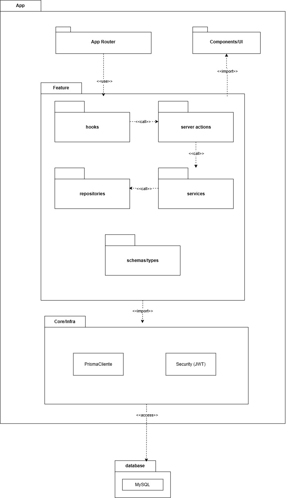
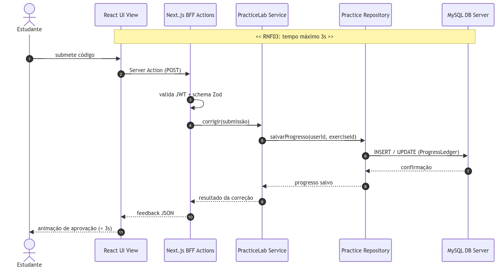
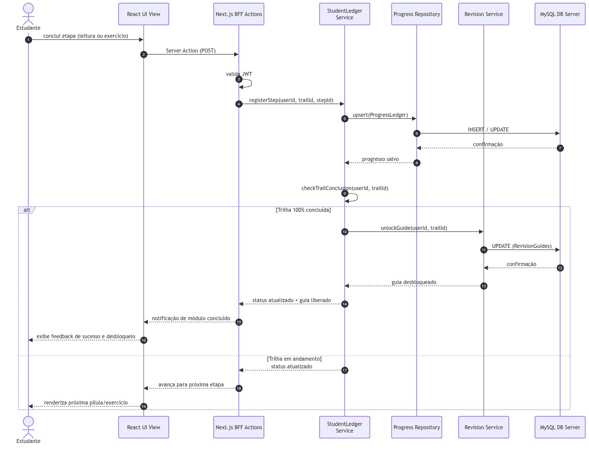
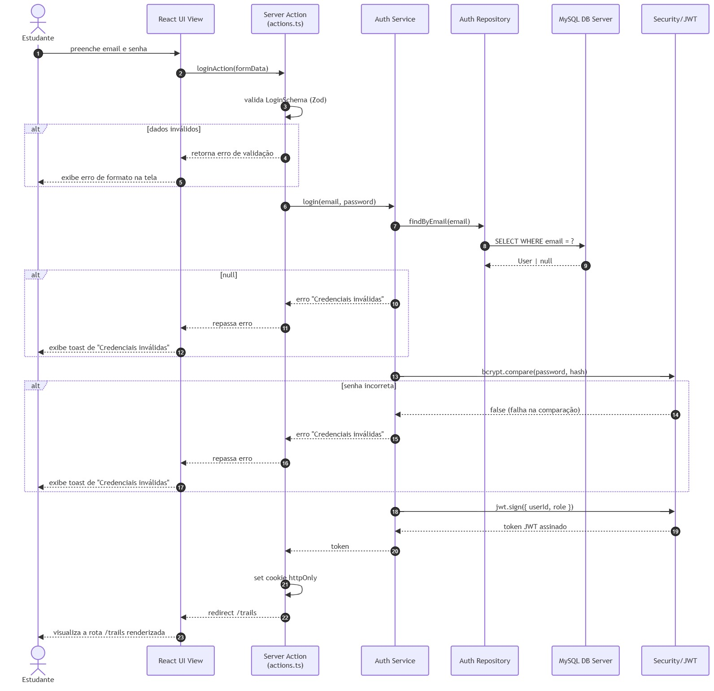
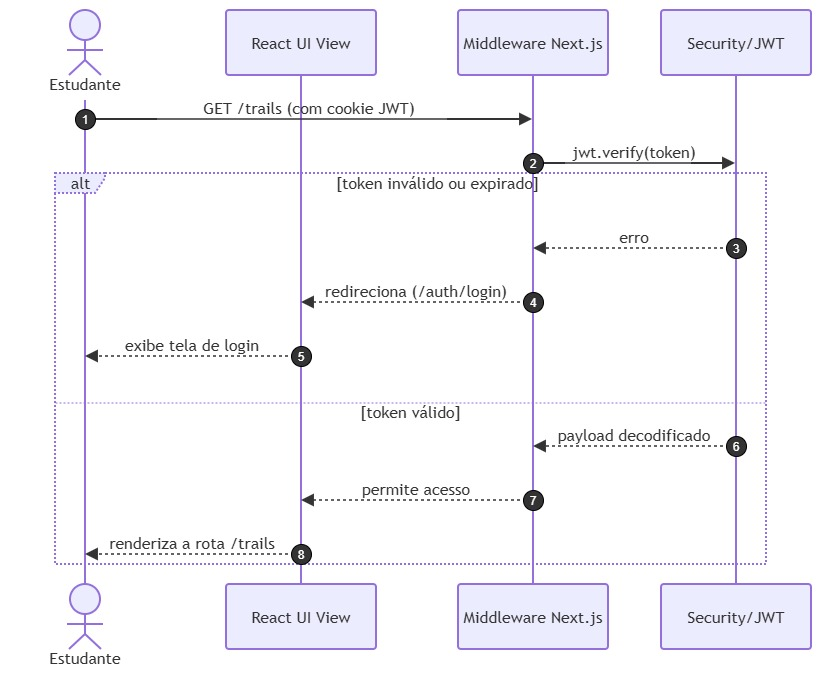
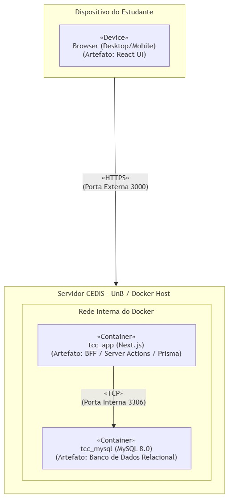
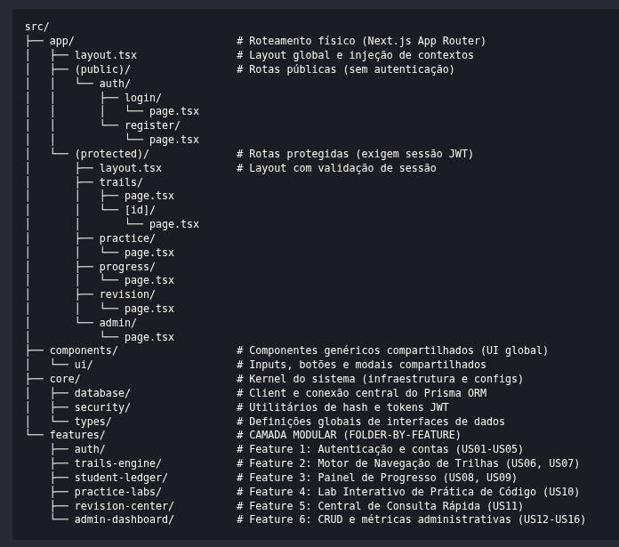
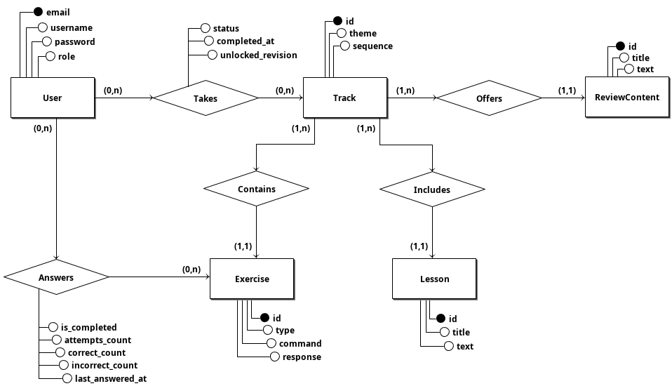
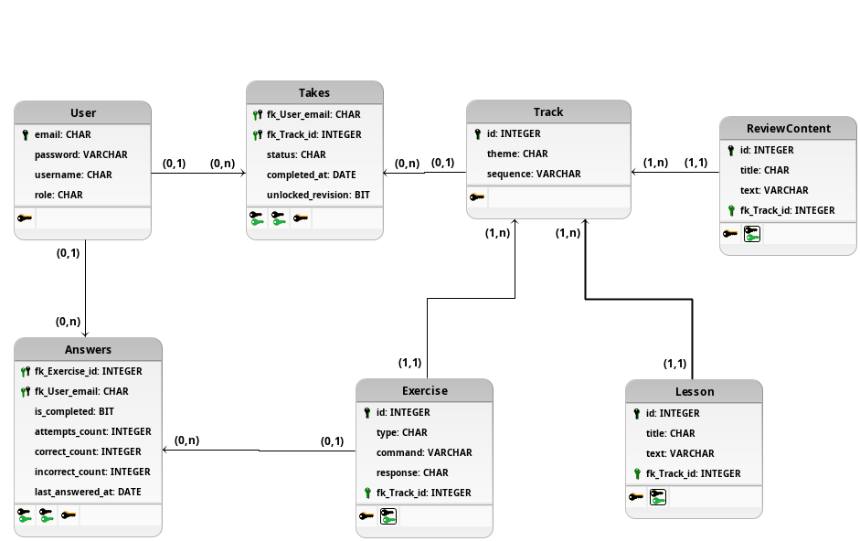

# Documento de Arquitetura de Software

_Plataforma de Apoio ao Aprendizado de Segurança de Software_

**Projeto:** AEGIS – AI, Ética e Gestão de Integridade em Software

**Versão:** 1.3

**Data:** 17 de Agosto de 2026

**Autores:**
João Pedro Rodrigues Morbeck e Pedro Henrique da Silva Melo

**Universidade de Brasília (UnB)** - 
**Faculdade de Ciências e Tecnologias em Engenharia (FCTE)** - 
**Curso de Engenharia de Software**

---

## 1. Introdução

### 1.1 Propósito

Este Documento de Arquitetura de Software (DAS) fornece uma visão técnica abrangente e estruturada para a plataforma de suporte ao aprendizado de desenvolvimento seguro e auditoria de Inteligência Artificial (IA) no contexto do Trabalho de Conclusão de Curso (TCC) em Engenharia de Software da Faculdade de Ciências e Tecnologias em Engenharia (FCTE/UnB). Ele serve como especificação de referência para os desenvolvedores e professores avaliadores, detalhando as decisões de design, padrões arquiteturais e a rastreabilidade direta dos requisitos funcionais (RFs) e não funcionais (RNFs) levantados no TCC 1.

### 1.2 Escopo

O escopo arquitetural deste documento cobre o ecossistema unificado da aplicação, construído sobre a tecnologia **Next.js (React.js)** no frontend e no backend (Backend-for-Frontend - BFF), conectando-se à nuvem do **Prisma ORM (MySQL)** para a persistência e segurança dos dados. O software implementará uma abordagem orientada a _microlearning_ e trilhas adaptativas de aprendizado. Ele não visa atuar na fase de implementação de código industrial via análise estática ou dinâmica automatizada em servidores de produção, mas foca na fundamentação e fonte de apoio de estudantes de engenharia de software para que possam conhecer e iniciar um estudo em desenvolvimento de software seguro antes do ingresso na indústria de tecnologia.

### 1.3 Definições, Acrônimos e Abreviações

A tabela abaixo consolida os principais conceitos, termos técnicos e acrônimos utilizados no decorrer deste artefato arquitetural:

| Acrônimo / Termo                 | Definição Técnica                                                                                                                                                                                                                                                                                                                                                   |
| -------------------------------- | ------------------------------------------------------------------------------------------------------------------------------------------------------------------------------------------------------------------------------------------------------------------------------------------------------------------------------------------------------------------- |
| **Next.js**                      | _Framework_ React voltado para produção que possibilita renderização híbrida no servidor (SSR) e geração estática estendida, unificando rotas e controle sob Server Actions.                                                                                                                                                                                        |
| **BFF (Backend-for-Frontend)**   | Padrão de arquitetura onde uma camada de servidor é dedicada de forma exclusiva para servir e intermediar as necessidades de dados e rotas específicas da interface do cliente.                                                                                                                                                                                     |
| **Prisma ORM & MySQL**           | Prisma é um Object-Relational Mapper (ORM) de código aberto para Node.js e TypeScript que simplifica a modelagem e o acesso a bancos de dados. MySQL é um sistema gerenciador de banco de dados relacional (SGBD) confiável e amplamente utilizado na indústria, operando em conformidade com as propriedades ACID para garantir transações seguras e consistentes. |
| **Microlearning**                | Abordagem instrucional que fragmenta conteúdos extensos em pílulas de conhecimento, acompanhadas de exercícios imediatos de fixação rápida para aumentar a retenção cognitiva.                                                                                                                                                                                      |
| **JWT (JSON Web Token)**         | Token criptográfico estruturado em JSON usado para transmitir dados de sessão de forma segura e _stateless_ entre o cliente e o servidor de BFF.                                                                                                                                                                                                                    |
| **SoC (Separation of Concerns)** | Princípio de design de software focado em separar o código do programa em seções independentes, de modo que cada parte resolva uma única responsabilidade.                                                                                                                                                                                                          |
| **SAD / DAS**                    | Software Architecture Document (SAD) ou Documento de Arquitetura de Software (DAS) - o artefato formal de representação e desenho técnico do sistema.                                                                                                                                                                                                               |
| **Folder-by-Feature**            | Método de organização de diretórios onde os arquivos são agrupados por domínio de negócio/funcionalidade, e não pelo tipo de arquivo técnico.                                                                                                                                                                                                                       |

### 1.4 Referências

As decisões e modelagens apresentadas neste artefato arquitetural estão cientificamente fundamentadas nas seguintes obras e documentos de engenharia:

- <u>Kruchtem, Philippe (1995).</u> Architectural Blueprints — The "4+1" View Model of Software Architecture. IEEE Software, v. 12, n. 6, p. 42-50. Disponível em: [researchgate.net](https://www.researchgate.net/publication/280113621_Architectural_Blueprints_---_The_41_View_Model_of_Software_Architecture).
- _Dowd, M.; McDonald, J.; Schuh, J. (2006)._ The Art of Software Security Assessment: Identifying and Preventing Software Vulnerabilities. Addison-Wesley Professional.
- _Sommerville, Ian (2019)._ Engenharia de Software. 10ª Edição. Pearson Education.
- _Leffingwell, D.; Widrig, D. (2003)._ Managing Software Requirements: A Use Case Approach. 2ª Edição. Addison-Wesley Professional.

### 1.5 Visão Geral

Este documento está organizado seguindo a estrutura padrão RUP (_Rational Unified Process_) para DAS. A seção 2 introduz a representação arquitetural global (BFF de n-camadas). A seção 3 mapeia os objetivos e restrições técnicas amparados pelos requisitos não funcionais. A seção 4 apresenta a visão lógica baseada na decomposição de módulos (_features_) e na hierarquia física de pastas do Next.js. A seção 5 ilustra o fluxo dinâmico dos processos chaves. A seção 6 mapeia a implantação física (CEDIS e Prisma ORM), seguido pela visão de implementação na seção 7, representação de dados na seção 8, e considerações sobre tamanho, desempenho e qualidade nas seções 9 e 10.

---

## 2. Representação Arquitetural

Para assegurar um desenho de software robusto, flexível e academicamente defensável, adota-se o **Modelo de Visões 4+1 de Kruchten (1995)**. Este modelo decompõe a arquitetura do software sob as óticas de casos de uso (o coração que unifica o design), lógica (decomposição estrutural), processos (dinâmica e sincronização), física/implantação (hardware e infraestrutura) e implementação (organização física do código fonte). Apesar do modelo cobrir a ótica de casos de uso, este projeto não adota tal visão.

O estilo arquitetural escolhido baseia-se em uma **Arquitetura Cliente-Servidor de N-Camadas** com o uso integrado do padrão **Backend-for-Frontend (BFF)** embutido e centralizado sob o **Next.js App Router**. O lado cliente, operando em browsers de desktop ou smartphones, renderiza páginas responsivas por meio de componentes React reativos. O BFF intermediará de forma exclusiva todas as requisições de backend via Server Actions e API Routes, aplicando middlewares para a criptografia e proteção de rotas antes de bater nas tabelas e views estruturadas no banco relacional MySQL por meio do Prisma ORM.

---

## 3. Objetivos e Restrições Arquiteturais

A arquitetura deste software é restrita e moldada diretamente para atender aos cinco Requisitos Não Funcionais (RNFs) elicitados no TCC 1, as quais atuam como as metas de qualidade do sistema de _microlearning_:

- **Segurança (RNF01) como Meta de Confidencialidade:** A arquitetura blinda o sistema contra acessos indevidos. Todas as rotas administrativas são interceptadas no nível de rede do Next.js via _Middleware_, validando assinaturas criptográficas de tokens JWT. A segurança de isolamento de registros é garantida de forma lógica na camada de aplicação através das camadas de _Services_ e _Repositories_ do Prisma ORM, onde todas as consultas e escritas de dados filtram rigorosamente pelo identificador do usuário autenticado (userId) extraído da sessão segura, prevenindo vazamentos de progresso ou acesso a conteúdos de terceiros.
- **Usabilidade e Responsividade Multiplataforma (RNF02):** Para solucionar a dualidade observada no questionário aplicado no TCC1 (demanda por mobilidade no microlearning vs. necessidade de IDE para exercícios práticos complexos), o frontend foi projetado como uma aplicação _Web_ responsiva integrada. Utiliza-se React.js e Tailwind CSS para fornecer uma transição de interface fluida e adaptável a telas de smartphones, tablets e desktops.
- **Desempenho e Tempo de Resposta (RNF03):** Para manter o engajamento e a fluidez instrucional, o sistema possui o limite estrito de processar o feedback das avaliações de código e quizzes com tempo de resposta máximo de até 3 segundos. Isso é assegurado usando Server Actions assíncronas no Next.js e conexões estruturadas em pool otimizadas com o banco MySQL via Prisma ORM.
- **Suportabilidade e Modularidade (RNF04):** A arquitetura de software é projetada de forma extensível por meio do agrupamento por domínios. Isso possibilita que novas trilhas técnicas ou recursos lúdicos (features adicionais) sejam acoplados sem impacto ou refatoração do código existente.
- **Implementação e Inicialização (RNF05):** O ecossistema em nuvem é configurado para inicializar automaticamente a única conta administrativa preexistente e criar o catálogo técnico básico de trilhas a partir de rotas protegidas durante o bootstrap e inicialização da base de dados do MySQL via Prisma ORM.

---

## 4. Visão Lógica

Para concretizar o requisito não funcional de modularidade e suportabilidade (RNF04), a decomposição lógica do sistema abandona o padrão técnico monolítico e adota a arquitetura **Folder-by-Feature (Pasta por Funcionalidade)**. Os diretórios da aplicação Next.js estruturam-se sob módulos de domínio de negócio autossuficientes, contendo seus próprios componentes, _types_ e chamadas de API, facilitando a coesão interna e reduzindo o acoplamento global.

### 4.1 Organização das Rotas

A estrutura de rotas da aplicação segue o padrão de _Route Groups_ do Next.js App Router, agrupando as páginas pelo critério de proteção de acesso.

Rotas públicas, acessíveis sem autenticação, são isoladas no grupo `(public)` e compreendem as páginas de login e cadastro da plataforma.

Rotas protegidas, que exigem sessão JWT válida, são isoladas no grupo `(protected)` e compreendem todas as funcionalidades do estudante e do administrador.

Essa separação permite que o middleware de validação de token seja aplicado de forma centralizada sobre o grupo protegido, sem impactar as rotas de acesso público.

```
src/app/
├── (public)/
│   └── auth/
│       ├── login/
│       └── register/
└── (protected)/
    ├── trails/
    ├── trails/[id]/
    ├── practice/
    ├── progress/
    ├── revision/
    └── admin/
```

### 4.2 Organização das Features

A camada modular da aplicação adota o padrão Folder-by-Feature, no qual cada domínio de negócio é encapsulado em um módulo auto suficiente dentro de _src/features/_. Cada feature contém internamente uma divisão rígida em camadas, garantindo a Separação de Responsabilidades (SoC) e o isolamento lógico entre apresentação, controle, domínio e infraestrutura. O padrão interno de cada feature segue a seguinte estrutura:

```
features/[nome-da-feature]/
├── components/    → Apresentação (UI React)
├── hooks/         → Controle de Estados (client-side)
├── services/      → Domínio e Regras de Negócio (server-side)
├── types/         → DTOs e Schemas de Validação (Zod)
├── repositories/  → Infraestrutura de Dados (Prisma ORM)
└── actions.ts     → BFF Controller (Next.js Server Actions)
```

A árvore completa de features e a materialização física desse padrão em arquivos reais estão detalhadas na Seção 7.

### 4.3 Representação Visual (Diagrama de Pacotes)

Esta subseção apresenta o Diagrama de Pacotes UML do sistema, consolidando visualmente a decomposição arquitetural descrita nas subseções anteriores. O diagrama ilustra o encapsulamento e o isolamento lógico das features, as dependências internas entre as camadas de cada módulo e as dependências externas controladas com os pacotes compartilhados de infraestrutura (Core/Infra) e de interface (Components/UI).

> Nota: O pacote _schemas/types_ é importado pelos pacotes _server actions_, _services_ e _repositories_.

**Diagrama de Pacotes**



_Fonte: Autores_

---

## 5. Visão de Processo

A visão de processos demonstra a dinâmica de execução do sistema em tempo de execução. O sistema possui dois fluxos críticos documentados: o fluxo de autenticação e autorização, que materializa o requisito de segurança (RNF01), e o fluxo de validação assíncrona de exercícios práticos, regido pelo limite estrito de desempenho de 3 segundos (RNF03).

### 5.1 Fluxo de Submissão e Correção de Exercícios (practice-labs)

O fluxo crítico de validação assíncrona de exercícios práticos, regido pelo limite estrito de desempenho de 3 segundos (RNF03), ocorre por meio da seguinte sequência de processos integrados:

- **Gatilho do Usuário (Processo 1):** O estudante acessa o laboratório prático (practice-labs), preenche um código sanitizado ou revisa um código de IA vulnerável e clica em 'Enviar Resposta'.
- **Requisição Segura (Processo 2):** O cliente React envia os dados de forma assíncrona por meio de um método HTTP POST ou de uma Server Action criptografada para o servidor BFF do Next.js.
- **Filtro de Segurança (Processo 3):** O middleware do Next.js intercepta a chamada, valida a sessão stateless do token JWT e verifica se o usuário possui permissão legal (perfil ativo) para submeter aquele teste.
- **Validação Lógica no BFF (Processo 4):** O servidor BFF do Next.js executa o script de correção segura para avaliar as respostas do quiz ou checar o código de defesa submetido.
- **Persistência de Progresso (Processo 5):** Caso a resposta esteja correta, o Next.js atualiza o histórico de progresso do estudante, na trilha do exercício, no banco relacional MySQL via Prisma ORM.
- **Feedback em Tempo Real (Processo 6):** O BFF Next.js retorna o feedback formatado em JSON para o cliente React, que renderiza visualmente a animação de aprovação em menos de 3 segundos, mantendo a responsividade do layout.

#### 5.1.1 Representação Dinâmica (Diagrama de Sequência)

O Diagrama de Sequência (UML) abaixo descreve o comportamento dinâmico e o fluxo temporal de mensagens em tempo de execução para a submissão e correção de códigos vulneráveis ou revisões de IA no laboratório prático (practice-labs), regido pelo limite estrito de desempenho de até 3 segundos (RNF03). O diagrama detalha as chamadas síncronas e assíncronas nas camadas lógicas de software:

- **Estudante (Ator):** Efetua a submissão do código reescrito para a defesa da falha.
- **React UI View (Apresentação):** Dispara a Server Action criptografada de backend.
- **Next.js BFF Actions (BFF/Controle):** Intercepta a chamada no Middleware, valida o token JWT e invoca o respectivo serviço de domínio.
- **PracticeLab Service (Domínio):** Executa a lógica de negócio para conferir o gabarito ou auditar falhas.
- **Practice Repository (Infraestrutura):** Chama os comandos do Prisma Client para salvar e confirmar o progresso.
- **MySQL DB Server (Dados):** Registra a transação e confirma a alteração de progresso no ledger.

**Diagrama de Sequência - Submissão de Exercício**



_Fonte: Autores_

### 5.2 Consumo de Trilha e Desbloqueio

Este processo ocorre sempre que o estudante consome uma pílula teórica ou finaliza a última etapa prática de uma trilha. A arquitetura delega a responsabilidade de auditar o avanço do aluno ao módulo student-ledger, que se comunica com o revision-center apenas quando o critério de 100% de conclusão é atingido.

- **Estudante (Ator):** Marca uma leitura como concluída ou avança da última questão.
- **React UI View:** Envia o evento de progresso para o servidor.
- **StudentLedger Service (Domínio):** Registra a etapa concluída e verifica se todas as dependências da Trilha foram finalizadas.
- **Revision Service (Domínio):** Invocado condicionalmente caso a trilha esteja 100% concluída, para liberar o Guia de Revisão atrelado.

**Diagrama de Sequência - Consumo de Trilha e Desbloqueio**



_Fonte: Autores_

### 5.3 Fluxo de Autenticação e Autorização

O diagrama de sequência abaixo descreve o comportamento dinâmico do sistema para os dois processos centrais de segurança exigidos pelo **RNF01**: a autenticação do usuário no momento do login e a autorização contínua de acesso às rotas protegidas via validação de token JWT.

**Processo 1 — Autenticação (Login):**

- **Estudante (Ator):** Preenche email e senha e submete o formulário de login.
- **React UI View (Apresentação):** Dispara a Server Action de login com os dados do formulário.
- **Server Action — actions.ts (BFF/Controle):** Valida o input via LoginSchema (Zod). Em caso de dados inválidos, retorna erro de validação imediatamente.
- **Auth Service (Domínio):** Recebe as credenciais validadas, aciona o repositório para localizar o usuário e compara a senha submetida com o hash armazenado via bcrypt.
- **Auth Repository (Infraestrutura):** Executa a consulta ao banco MySQL via Prisma Client. Retorna o registro do usuário ou nulo caso não exista.
- **MySQL DB Server (Dados):** Processa a consulta e retorna o registro correspondente ao email informado.
- **Security/JWT (Core/Infra):** Em caso de credenciais válidas, assina um token JWT contendo o identificador e o perfil do usuário.
- **Server Action — actions.ts (BFF/Controle):** Persiste o token em um cookie httpOnly e redireciona o cliente para a rota `/trails`.

**Diagrama de Sequência - Processo de Autenticação/Login**



_Fonte: Autores_

**Processo 2 — Autorização (Acesso a Rotas Protegidas):**

- **Estudante (Ator):** Navega para qualquer rota do grupo `(protected)`.
- **Middleware Next.js (BFF/Controle):** Intercepta a requisição antes da renderização da página, extrai o token JWT do cookie e aciona a verificação criptográfica.
- **Security/JWT (Core/Infra):** Verifica a assinatura e a validade temporal do token. Retorna o payload decodificado ou lança erro em caso de token inválido ou expirado.
- **Middleware Next.js (BFF/Controle):** Em caso de token válido, permite o acesso e a renderização da rota solicitada. Em caso de falha, redireciona o usuário para `/auth/login`.

**Diagrama de Sequência - Processo de Autorização/Acesso**



_Fonte: Autores_

---

## 6. Visão de Implantação (Deploy)

A topologia de implantação física do sistema de microlearning adota uma infraestrutura centralizada e conteinerizada, hospedada em um servidor dedicado mantido pelo laboratório **CEDIS** da Universidade de Brasília (UnB). Esta abordagem garante controle total sobre o ambiente de execução, otimização de recursos e latência de rede quase nula entre os serviços internos:

- **Hospedagem Frontend/Backend (BFF):** A aplicação modular Next.js é implantada no servidor do CEDIS utilizando a tecnologia Docker para o isolamento do ambiente de execução. O contêiner Node.js atua de forma contínua como o Backend-for-Frontend (BFF) da plataforma, processando dinamicamente as respostas SSR (Server-Side Rendering) e centralizando a execução das Server Actions, garantindo a entrega ágil e responsiva das interfaces aos dispositivos dos estudantes.
- **Base de Dados Relacional e Segurança:** A persistência estruturada reside em um banco de dados relacional MySQL, instanciado como um contêiner independente e conectado ao BFF por meio de uma rede virtual interna do Docker (Docker Network). A comunicação entre a aplicação Next.js e o banco de dados ocorre de forma direta e protegida via protocolo TCP (porta interna 3306) utilizando o Prisma ORM. Essa topologia elimina a latência de rede externa característica de integrações em nuvem, sendo fundamental para o estrito cumprimento do tempo de resposta máximo de 3 segundos nas correções e submissões.

**Diagrama de Implantação**



_Fonte: Autores_

---

## 7. Visão de Implementação

A organização física e as responsabilidades de desenvolvimento dentro de cada pasta de Feature seguem uma divisão interna rigorosa em seis camadas de software (Separation of Concerns). Isso previne que a lógica de banco de dados se misture com componentes visuais da UI:

- **1. Camada de Apresentação (Interface React.js):** Composta por arquivos de componentes visuais (.tsx). Cuidam estritamente da renderização da interface e layout responsivo. Não possuem lógica de negócios, chamadas diretas a banco de dados ou consultas cruas de dados. Toda a estilização é injetada de forma declarativa via Tailwind CSS.
- **2. Camada de Controle e Estados (Custom Hooks / Context API):** Contida em hooks customizados (ex: `useTrails.ts` ou `usePractice.ts`). Gerenciam os estados locais e globais reativos e encapsulam a chamada a funções assíncronas do servidor.
- **Camada de Domínio e Regras de Negócio (services/):** Contém a lógica de negócio da feature rodando exclusivamente no lado do servidor. É aqui que valida-se regras, orquestra-se chamadas ao repositório e aplica-se a sanitização de dados antes da persistência.
- **Especificação de Dados (types/):** Contém os DTOs (Data Transfer Objects) e Schemas de validação Zod que definem o contrato de dados compartilhado entre as camadas da feature. Garante consistência de tipos de ponta a ponta, do input do cliente até a persistência no banco.
- **Camada de BFF e Controle (actions.ts):** Ponto de entrada server-side da feature. Valida o input via LoginSchema (Zod), aplica a verificação de autenticação e delega a execução para os respectivos serviços (_services_) de domínio.
- **Camada de Infraestrutura e Dados (Repositories / Prisma Clients):** Camada isolada de persistência. Contém os arquivos responsáveis por mapear queries, filtros e conexões com as tabelas relacionais do MySQL usando os métodos do _Prisma Client_, aplicando o padrão de Repositório para blindar o restante do software de persistência.

Para materializar as camadas a nível de código, abaixo especifica-se a árvore física de diretórios que materializa essa visão do software em produção:



_Fonte: Autores_

Dessa forma, a **camada modular** pode ser trabalhada com a divisão seguindo a seguinte árvore física de diretório, como exemplo da de autenticação:

```
features/auth/
├── components/        # APRESENTAÇÃO (UI React)
│   ├── sign-in.tsx
│   ├── sign-up.tsx
│   └── index.ts
├── hooks/             # CONTROLE DE ESTADOS (Client-Side)
│   ├── use-auth.ts    # Hook que gerencia o estado local reativo de login
│   └── index.ts
├── services/          # DOMÍNIO / REGRAS DE NEGÓCIO (Server-Side)
│   ├── auth.ts        # Lógica de negócio (validações, bcrypt, tokens)
│   └── index.ts
├── types/             # ESPECIFICAÇÃO DE DADOS E SCHEMAS
│   ├── auth.types.ts  # DTOs (Data Transfer Objects) e Schemas do Zod
│   └── index.ts
├── repositories/      # INFRAESTRUTURA DE DADOS (Prisma ORM & MySQL)
│   ├── auth.repository.tsx  # Consultas e escritas diretas via Prisma Client
│   └── index.ts
├── actions.ts         # BFF CONTROLLER (Next.js Server Actions)
└── index.ts           # Ponto de exportação pública da Feature
```

---

## 8. Visão de Dados

O modelo lógico de dados relacional (MySQL) é projetado para garantir a integridade referencial das trilhas de aprendizado de desenvolvimento seguro e as regras de desbloqueio de conteúdo. A estrutura de tabelas e relacionamentos contempla as seguintes entidades e tabelas associativas:

- **Tabela User (Contas dos Usuários):** Persiste o identificador único por email (PK), username, hash seguro de senha (password) e o papel do usuário no sistema (_role_, como _student_ ou _admin_).
- **Tabela Track (Catálogo de Trilhas):** Armazena o identificador da trilha (id PK), o tema principal abordado (theme) e a ordem de progressão (sequence).
- **Tabela Lesson (Pílulas de Conhecimento):** Registra as lições teóricas associadas a uma trilha, contendo o identificador (id PK), título (title), conteúdo instrucional (text) e a chave estrangeira referenciando a trilha de origem (fk_Track_id).
- **Tabela Exercise (Questões Práticas de Lab):** Registra as atividades e desafios práticos, persistindo o identificador (id PK), tipo de exercício (type), enunciado/código (command), a resposta/gabarito esperado (response) e a chave estrangeira vinculada à trilha (fk_Track_id).
- **Tabela ReviewContent (Guias de Revisão):** Armazena o material complementar e cheatsheets desbloqueáveis, contendo id (PK), título (title), corpo do texto (text) e a chave estrangeira associada à respectiva trilha finalizada (fk_Track_id).
- **Tabela Takes (Progresso e Estado da Trilha):** Tabela associativa que vincula User e Track com chave primária composta (fk_User_email, fk_Track_id). Registra o estado atual do estudante na trilha (status), data de conclusão (completed_at) e a liberação de acesso ao guia de revisão (unlocked_revision).
- **Tabela Answers (Desempenho em Exercícios):** Tabela associativa que vincula User e Exercise com chave primária composta (fk_Exercise_id, fk_User_email). Utiliza contadores acumuladores para registrar se o exercício foi concluído (is_completed), total de tentativas (attempts_count), quantidade de acertos (correct_count), erros (incorrect_count) e a data da última submissão (last_answered_at).

A seguir, encontram-se o Diagrama Entidade-Relacionamento (DER) e o Diagrama Lógico de Dados (DLD) correspondentes, estruturados conforme o mapeamento acima.

**Diagrama Entidade-Relacionamento**



_Fonte: Autores_

**Diagrama Lógico de Dados**



_Fonte: Autores_

---

## 9. Tamanho e Performance

Para assegurar o estrito cumprimento de _feedback_ prático sob 3 segundos (RNF03), a arquitetura Next.js incorpora estratégias robustas de performance e dimensionamento de carga:

- **Server-Side Rendering (SSR) Dinâmico e Stateless:** Prioriza-se a renderização no servidor (SSR) para a entrega dinâmica e em tempo real das pílulas teóricas, laboratórios práticos e painéis de progresso. De modo a mitigar o overhead de banco de dados e garantir escalabilidade linear horizontal (scaling out), o servidor BFF no Next.js é implementado de forma totalmente stateless, transferindo o estado de sessão para tokens JWT criptografados mantidos pelo cliente. Além disso, as consultas pesadas de dados ao banco relacional MySQL via Prisma ORM são encapsuladas por pools de conexões eficientes e chamadas assíncronas assentes, mantendo a latência geral de renderização bem abaixo do limite de 3 segundos exigido pelo RNF03.
- **Code Splitting e Lazy Loading Automáticos:** Next.js decompõe o bundle Javascript em pedaços pequenos. O navegador do estudante carrega apenas os scripts necessários para a feature visualizada (ex: practice-labs), impedindo o desperdício de dados móveis no celular (RNF02).

---

## 10. Qualidade

A arquitetura de software unificada e de feature isolada (folder-by-feature) maximiza os índices de qualidade do projeto sob três perspectivas principais de suporte de engenharia:

- **Manutenibilidade e Testabilidade (RNF04):** Como cada módulo isola suas regras de domínio e chamadas de BFF, testes unitários e de integração podem ser desenvolvidos de forma isolada e localizados dentro da própria pasta da feature (ex: `/features/practice-labs/__tests__`).
- **Segurança e Auditoria do Código (RNF01):** Ao longo do pipeline CI/CD no GitHub, devem ser executadas rotinas de análise estática de segurança (SAST) para auditar vulnerabilidades conhecidas no código, garantindo que a própria plataforma de suporte ao desenvolvimento seguro seja à prova de falhas graves.
- **Independência de Camadas:** A separação estrita de camadas na feature isola falhas. Caso ocorra um erro de renderização gráfica ou CSS no painel responsivo, a camada controladora ou a consistência transacional do progresso no banco relacional MySQL via Prisma ORM continuará blindada e intacta.

---

## Histórico de Revisão

O histórico de revisões registra todas as modificações formais efetuadas no Documento de Arquitetura de Software (DAS), garantindo o controle de versão e a rastreabilidade das decisões de _design_.

| Data        | Versão | Descrição                                                                                                                                                                                   | Autores                    |
| ----------- | ------ | ------------------------------------------------------------------------------------------------------------------------------------------------------------------------------------------- | -------------------------- |
| 17/Ago/2026 | 1.0    | Elaboração e detalhamento inicial da arquitetura do sistema baseado na stack Next.js e no padrão de pastas modular Folder-by-Feature para o início das Sprints de desenvolvimento do TCC 2. | P. H. Melo                 |
| 23/Ago/2026 | 1.1    | Desenvolvimento dos diagramas de pacote, sequência e de implantação                                                                                                                         | P. H. Melo                 |
| 25/Ago/2026 | 1.2    | DER e DLD, revisão geral do documento                                                                                                                                                       | P. H. Melo e J. P. Morbeck |
| 01/Nov/2026 | 1.3    | Alteração do nome do projeto                                                                                                                                                       | J. P. Morbeck |
