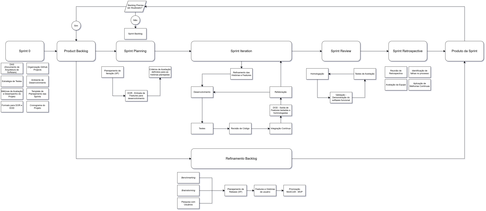

# Metodologia de Desenvolvimento

## 1. Abordagem adotada

O desenvolvimento da plataforma adota uma abordagem híbrida **Scrum + XP (Extreme Programming)**. O Scrum organiza o trabalho em sprints, com planejamento, acompanhamento do backlog, revisão do incremento e retrospectiva. O XP complementa esse fluxo com planejamento de releases e práticas técnicas de desenvolvimento, como programação em pares, testes, revisão de código, integração contínua e refatoração.

A metodologia é aplicada pela dupla responsável pelo projeto. Os registros identificam os dois autores como participantes das sprints e registram contribuições do orientador, de stakeholders e de usuários como fontes de feedback.

## 2. Planejamento e priorização do produto

O planejamento começa com a coleta de informações por *benchmarking*, *brainstorming* e pesquisa com usuários. Essas entradas apoiam o planejamento de release em XP e a definição de *features* e histórias de usuário. As *features* são priorizadas pela técnica MoSCoW e organizadas em MVPs, conforme os critérios de valor de negócio, viabilidade e facilidade de implementação descritos no [documento de requisitos](../requirements/docs_requisitos_v2.md).

As histórias priorizadas compõem o **Product Backlog**, mantido no GitHub Projects. O backlog é refinado continuamente: após a entrega de cada incremento, a equipe avalia se ele precisa de atualização antes de iniciar um novo ciclo. Novas informações, feedback e mudanças de prioridade podem levar à revisão das histórias e do escopo dos MVPs.

## 3. Ciclo de desenvolvimento

O fluxo adotado, representado no [diagrama da metodologia](./images/MD-TCC.png), é:

1. **Sprint 0 — preparação:** definição da arquitetura, dos requisitos, das *features* e dos MVPs; elaboração das estratégias de teste e dos critérios de pronto e concluído; e preparação do ambiente de desenvolvimento.
2. **Sprint Planning:** seleção de histórias do Product Backlog para compor o **Sprint Backlog**, definição do objetivo da sprint e verificação de que as histórias atendem à *Definition of Ready* (DoR).
3. **Sprint Iteration:** refinamento das histórias e *features* selecionadas e execução do desenvolvimento. A equipe implementa as histórias, realiza testes e revisão de código, executa a integração contínua e refatora quando necessário. Falhas encontradas retornam ao desenvolvimento e à validação até que os critérios de conclusão sejam atendidos.
4. **Homologação e testes de aceitação:** demonstração do software funcional, execução dos testes de aceitação e verificação dos critérios de aceitação. Histórias atendidas são homologadas como parte do incremento da sprint.
5. **Sprint Review:** apresentação do incremento e coleta de feedback do orientador, de stakeholders e, quando aplicável, de usuários.
6. **Sprint Retrospective:** avaliação do processo de trabalho, identificação de dificuldades e definição de ações de melhoria contínua para as próximas sprints.
7. **Refinamento do backlog:** atualização do Product Backlog com os resultados da sprint e os feedbacks recebidos, iniciando o próximo ciclo.

Abaixo segue a representação do diagrama

    Fonte: Elaborado pelos autores.

A Sprint 0 é dedicada à preparação do projeto. As sprints seguintes têm duração aproximada de duas semanas, conforme os cronogramas planejado e executado. O objetivo da sprint e as histórias selecionadas são registrados no respectivo [relatório de sprint](../../process/sprints/template_de_sprint.md).

## 4. Práticas de desenvolvimento e qualidade

Durante a Sprint Iteration, a equipe aplica as práticas de XP documentadas para manter a qualidade do incremento:

- **Programação em pares e revisão de código:** revisão do trabalho antes de sua conclusão.
- **Testes:** análise estática e verificação de tipos, testes unitários, de integração e de ponta a ponta, conforme a [estratégia de testes](../../process/strategies/estrategia_testes.md).
- **Integração contínua:** execução das verificações automatizadas a cada integração.
- **Refatoração:** melhoria interna do código, seguida da repetição das verificações pertinentes.
- **Testes de aceitação e homologação:** validação das histórias contra os critérios definidos e demonstração do software funcional.

### 4.1 Definition of Ready (DoR)

Uma história está pronta para ser planejada quando:

- está descrita no formato “Como / Quero / Para”;
- tem critérios de aceitação definidos e compreendidos pela equipe;
- foi refinada tecnicamente, com tarefas ou pequenos lotes de trabalho identificados; e
- não possui impedimentos técnicos nem dependências pendentes.

### 4.2 Definition of Done (DoD)

Uma história só é movida para **Validado** quando todos os itens abaixo forem atendidos:

- código implementado e revisado por programação em pares ou revisão de código;
- testes unitários escritos e aprovados, com cobertura mínima de 80%;
- integração contínua executada sem falhas;
- todos os critérios de aceitação atendidos; e
- ausência de regressões em funcionalidades existentes.

A conformidade com a DoR e a DoD é registrada como checklist. A transição de etapa requer 100% dos itens aplicáveis concluídos, de acordo com o [plano de métricas e acompanhamento](../../process/strategies/estrategia_acompanhamento_projeto.md).

## 5. Acompanhamento e melhoria contínua

O GitHub Projects é a fonte de acompanhamento do fluxo de trabalho, com os estados **A fazer**, **Em desenvolvimento** e **Validado**. A equipe acompanha a vazão — histórias ou *features* que chegam a Validado por sprint —, o progresso acumulado do MVP e os defeitos registrados como *issues*.

Na aplicação de *Yesterday's Weather*, prática de XP, a vazão realizada na sprint anterior orienta a capacidade inicial planejada para a seguinte. Com mais histórico, o plano de métricas recomenda usar a média das duas ou três sprints mais recentes. As retrospectivas analisam desvios, impedimentos e tendências de defeitos e definem ações para ajustar o processo.

## 6. Referências do processo

- [Requisitos, priorização MoSCoW e MVPs](../requirements/docs_requisitos_v2.md)
- [Plano de métricas e acompanhamento do projeto](../../process/strategies/estrategia_acompanhamento_projeto.md)
- [Estratégia de garantia da qualidade e testes](../../process/strategies/estrategia_testes.md)
- [Modelo de relatório de sprint](../../process/sprints/template_de_sprint.md)

---

## Histórico de Revisão

O histórico registra as modificações formais realizadas neste documento, garantindo o controle de versão e a rastreabilidade das decisões sobre a metodologia de desenvolvimento.

| Data        | Versão | Descrição                                             | Autores                    |
| ----------- | ------ | ----------------------------------------------------- | -------------------------- |
| 02/Nov/2026 | 1.0    | Documentação da metodologia de desenvolvimento Scrum + XP | J. P. Morbeck e P. H. Melo |
