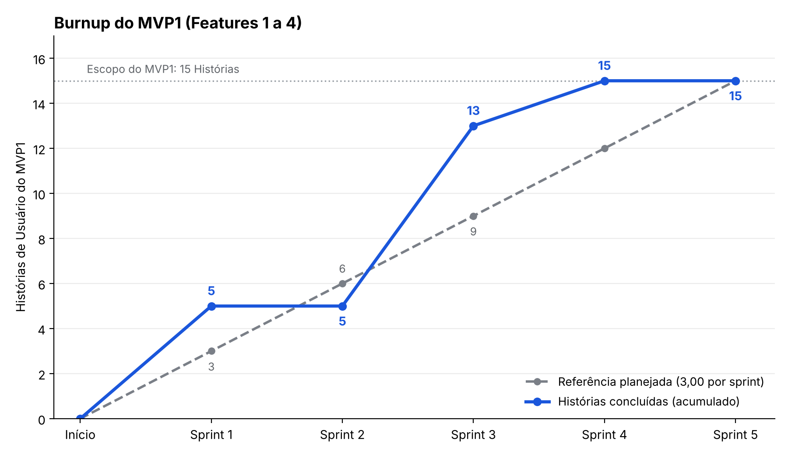

# Registro de Métricas e Análises por Sprint

*Plataforma de Apoio ao Aprendizado de Segurança de Software — TCC*

## 1. Introdução

Este documento registra as métricas coletadas ao longo das sprints do projeto e as análises feitas a partir delas. Ele aplica o [Plano de Métricas e Acompanhamento do Projeto](estrategia_acompanhamento_projeto.md).

Os dados foram extraídos do quadro do GitHub Projects pelo repositório AEGIS em **07/11/26**, a partir do estado atual dos 39 itens e do histórico de mudanças de status de cada issue.

## 2. Critérios de Medição

!!! note "Como os números foram obtidos"

    - **Sprint de conclusão:** vale a sprint em que o item foi entregue e validado, conforme o relatório de cada sprint (Sprint Review) e o quadro. Para as Histórias de Usuário e as tarefas listadas nos relatórios, vale o que a Review registrou como "Entregue". Para os demais itens, vale a data de fechamento da issue.
    
    - **Sprint 1 estendida:** a Sprint 1 foi considerada encerrada em 24/09/26. A equipe não conseguiu fechá-la dentro do período planejado (07/09 a 20/09, Review em 21/09) e usou os dias adicionais para contabilizar as métricas de fechamento. A Sprint 2 passa a ser contada a partir de 25/09.
    - **Fechamento no quadro depois da Review:** 8 Histórias da Sprint 3 (US06 a US09 e US12 a US15) constam como "Entregue" na Review de 19/10, mas foram movidas para "Done" apenas em 25/10. Da mesma forma, 4 itens de Security da Sprint 4 (#15, #32, #34 e #37) constam como "Entregue" na Review de 02/11 e foram fechados entre 03/11 e 04/11. Esses itens foram contabilizados na sprint da Review.
    - **Janelas das sprints:** 
        - Sprint 1 de 07/09 a 24/09;
        - Sprint 2 de 25/09 a 06/10; 
        - Sprint 3 de 07/10 a 19/10; 
        - Sprint 4 de 20/10 a 02/11; 
        - Sprint 5 de 03/11 a 13/11.
    - **Vazão:** conta todos os itens concluídos na sprint, de qualquer tipo (Histórias de Usuário, Fix, Security, Docs, Task, Test, Requisitos e Protótipos), independentemente do tamanho.
    - **Escopo do MVP:** as 15 Histórias de Usuário das Features 1 a 4 (US01 a US15), que compõem o MVP1 (Must have).
    - **Burnup:** usa apenas as Histórias de Usuário do MVP concluídas, porque o escopo do MVP é medido em Histórias.
    - **Defeitos:** os itens de tipo Fix são tratados como ajustes de defeitos encontrados. Um defeito é "aberto" na sprint em que a issue foi criada e "corrigido" na sprint em que foi fechada.

## 3. Parâmetros do MVP

    Tabela 1 - Parâmetros do MVP

| Parâmetro | Valor | Observação |
|---|---|---|
| Escopo total do MVP (Histórias Must have) | 15 | US01 a US15 (Features 1, 2, 3 e 4) |
| Sprints previstas até o MVP | 5 | Sprints de desenvolvimento do projeto |
| Referência planejada por sprint | 3,00 | Escopo total ÷ Sprints previstas |
| Sprints realizadas | 5 | |

    Fonte: Elaborado pelos autores.

## 4. Levantamento do Backlog por Sprint

Itens que chegaram a "Done" em cada sprint, com a data de conclusão registrada no quadro.

### 4.1 Sprint 1 (07/09/26 a 20/09/26, fechamento em 24/09/26)

**Objetivo da sprint:** Desenvolver as fundações de autenticação, gestão de contas e o motor de navegação e mapa interativo das trilhas (US01 a US07).

    Tabela 2 - Itens concluídos na Sprint 1

| Issue | Tipo | Título | Fechada no quadro em |
|---|---|---|---|
| #1 | História (US) | US01 - Cadastrar na plataforma de estudos | 21/09/26 16:27 |
| #8 | Fix | Fix: Ajustar o campo de senha no formulário de cadastro | 22/09/26 18:29 |
| #2 | História (US) | US02 - Visualizar as informações do perfil de usuário. | 24/09/26 16:25 |
| #3 | História (US) | US03 - Editar as informações do perfil | 24/09/26 16:25 |
| #4 | História (US) | US04 - Deletar a conta da plataforma | 24/09/26 16:25 |
| #5 | História (US) | US05 - Como administrador, Visualizar as informações da conta. | 24/09/26 16:25 |

    Fonte: Elaborado pelos autores, com dados do GitHub Projects.

**Concluídos:** 6 (5 Histórias de Usuário, 1 Fix)

As US01 a US05 foram validadas até o fechamento da sprint em 24/09/26. As US06 e US07, também citadas no objetivo, ficaram pendentes e foram entregues na Sprint 3. O Fix #8 não fazia parte do planejamento.

### 4.2 Sprint 2 (22/09/26 a 06/10/26, contagem a partir de 25/09/26)

**Objetivo da sprint:** Desenvolver o motor de navegação e mapa interativo das trilhas (Feature 2) e os laboratórios de prática, avaliação e apresentação de conteúdo (Feature 4). Durante o planejamento, a sprint passou a priorizar o refinamento de requisitos dessas features.

    Tabela 3 - Itens concluídos na Sprint 2

| Issue | Tipo | Título | Fechada no quadro em |
|---|---|---|---|
| #13 | Test | Test: Criar testes unitários, testes E2E e testes de integração | 27/09/26 18:10 |
| #20 | Docs | Docs: Formalizar e Definir Diretrizes para Desenvolvimento de Software Seguro | 28/09/26 17:50 |
| #26 | Security | Security: Aplicar Diretrizes de Segurança no Projeto | 05/10/26 17:37 |
| #25 | Requisitos | Requisitos: Estrutura para Apresentação do Conteúdo das Trilhas | 05/10/26 17:38 |
| #23 | Docs | Docs: Documentar decisões técnicas e refinamento de Requisitos | 05/10/26 17:39 |
| #30 | Protótipo | Desenvolver Protótipos para Features de Trilhas e Apresentação de Conteúdo/Exercícios | 06/10/26 17:13 |

    Fonte: Elaborado pelos autores, com dados do GitHub Projects.

**Concluídos:** 6 (1 Security, 2 Docs, 1 Test, 1 Requisitos, 1 Protótipo)

Nenhuma História de Usuário foi concluída na sprint, porque ela foi dedicada aos requisitos de software: a definição de como apresentar as trilhas e o conteúdo aos usuários, o refinamento de cada requisito em Histórias e a prototipação das Features 2 e 4. Nela também foram desenvolvidas e formalizadas as estratégias de segurança do projeto, com as diretrizes e os checklists de segurança. As 8 Histórias do planejamento (US06 a US09 e US12 a US15) foram repassadas para a Sprint 3.

### 4.3 Sprint 3 (06/10/26 a 19/10/26)

**Objetivo da sprint:** Desenvolver o motor de navegação e mapa das trilhas (Feature 2), os laboratórios de prática, avaliação e apresentação de conteúdo (Feature 4) e o painel de progresso do estudante (Feature 3), repassados da sprint anterior (US06 a US15).

    Tabela 4 - Itens concluídos na Sprint 3

| Issue | Tipo | Título | Fechada no quadro em |
|---|---|---|---|
| #6 | História (US) | US06 - Acessar o catálogo de trilhas com visualização em cards | 25/10/26 18:14 |
| #7 | História (US) | US07 - Visualizar o fluxo da trilha estruturado em nós e carregar a tela de conteúdo ao acionar um nó | 25/10/26 18:17 |
| #39 | História (US) | US08 - Visualizar e Revisitar Nós já Concluídos | 25/10/26 18:17 |
| #40 | História (US) | US09 - Visualizar Nó de Teste Final para Conclusão da Trilha | 25/10/26 18:19 |
| #41 | História (US) | US12 - Acessar o Conteúdo Teórico do Nó de Leitura | 25/10/26 18:23 |
| #42 | História (US) | US13 - Acessar Nó de Exercício para Conteúdo Prático | 25/10/26 18:24 |
| #43 | História (US) | US14 - Acessar Nó de Teste Final da Trilha | 25/10/26 18:37 |
| #44 | História (US) | US15 - Submeter Resposta e Validar Exercícios | 25/10/26 18:44 |

    Fonte: Elaborado pelos autores, com dados do GitHub Projects.

**Concluídos:** 8 (8 Histórias de Usuário)

As US06 a US09 e US12 a US15 foram entregues na Review de 19/10/26, mas movidas para "Done" no quadro apenas em 25/10/26. As US10 e US11 (Feature 3), também planejadas, ficaram pendentes e foram entregues na Sprint 4.

### 4.4 Sprint 4 (20/10/26 a 02/11/26)

**Objetivo da sprint:** Finalizar a implementação do MVP1 com a Feature 3 (Painel de Progresso, US10 e US11) e as tarefas de configuração de segurança e de ajuste do projeto (9 tarefas planejadas).

    Tabela 5 - Itens concluídos na Sprint 4

| Issue | Tipo | Título | Fechada no quadro em |
|---|---|---|---|
| #58 | História (US) | US11 - Visualizar Progresso Geral na Plataforma | 29/10/26 14:59 |
| #57 | História (US) | US10 - Visualizar Percentual de Progresso em uma Trilha | 29/10/26 14:59 |
| #14 | Fix | Fix: Padronizar cores e atributos de estilização do projeto | 01/11/26 15:17 |
| #16 | Fix | Fix: Ajustar a responsividade das páginas | 01/11/26 15:17 |
| #33 | Security | Security: Implementar Rate Limiting no Login | 02/11/26 15:41 |
| #36 | Security | Security: Adicionar indicador de força de senha | 02/11/26 15:41 |
| #35 | Security | Security: Automatizar verificação de vulnerabilidades de dependências | 02/11/26 20:29 |
| #32 | Security | Security: Não expor mensagens internas de erros ao cliente | 03/11/26 17:45 |
| #34 | Security | Security: Configurar cabeçalhos HTTP de segurança | 03/11/26 19:45 |
| #37 | Security | Security: Publicar Política de Privacidade e disponibilizar link | 03/11/26 19:45 |
| #15 | Security | Security: Implementar tokens access + refresh | 04/11/26 21:40 |

    Fonte: Elaborado pelos autores, com dados do GitHub Projects.

**Concluídos:** 11 (2 Histórias de Usuário, 2 Fix, 7 Security)

Os 7 itens de Security (#15, #32, #33, #34, #35, #36 e #37) e as 2 correções (Fix #14 e #16) constam como "Entregue" na Review de 02/11/26. Quatro dos itens de Security (#15, #32, #34 e #37) foram fechados no quadro apenas em 03/11 e 04/11. As US10 e US11 foram fechadas em 29/10/26.

### 4.5 Sprint 5 (02/11/26 a 13/11/26, em andamento)

**Objetivo da sprint:** Validação do MVP1 com clientes usuários por meio de entrevistas e deploy da aplicação em produção, com as trilhas cadastradas (3 tarefas planejadas).

    Tabela 6 - Itens concluídos na Sprint 5

| Issue | Tipo | Título | Fechada no quadro em |
|---|---|---|---|
| #54 | Docs | Docs: Atualizar Cronograma - Planejado X Executado | 03/11/26 17:06 |
| #27 | Docs | Docs: Atualização no Processo de Desenvolvimento | 03/11/26 17:06 |
| #38 | Docs | Docs: Estilizar e padronizar Layout para GitPages | 03/11/26 17:06 |
| #61 | Task | Task: Criar imagem Docker para build e deploy da aplicação | 03/11/26 19:46 |

    Fonte: Elaborado pelos autores, com dados do GitHub Projects.

**Concluídos:** 4 (3 Docs, 1 Task)

Os 4 itens concluídos (#27, #38, #54 e #61) não estavam no planejamento da sprint. As tarefas planejadas ainda estão em andamento em 07/11/26: #62 (criação e revisão das trilhas) e #63 (trilhas no banco de produção), ambas em "In review", e a validação com usuários (entrevistas), ainda pendente. Também seguem abertos #71 (Docs, em "In progress") e #59 (Task, em "Backlog").

## 5. Métricas Consolidadas por Sprint

A coluna **Planejadas** informa quantos itens estavam no planejamento de cada sprint, conforme o relatório da própria sprint:

- Sprint 1: as 7 Histórias do objetivo, de US01 a US07.
- Sprint 2: as 8 Histórias das Features 2 e 4: US06 a US09 e US12 a US15.
- Sprint 3: as 10 Histórias que a sprint planejou: as 8 repassadas da Sprint 2 (US06 a US09 e US12 a US15) e as 2 Histórias da Feature 3 (US10 e US11).
- Sprint 4: 2 Histórias (US10 e US11) e 9 tarefas de segurança e de ajustes do projeto, como responsividade, padronização de cores, cabeçalhos HTTP, política de privacidade, indicador de força de senha, rate limiting, tokens de acesso e refresh, verificação de vulnerabilidades e tratamento de mensagens de erro.
- Sprint 5: 3 tarefas, sendo a criação e revisão das trilhas, a inclusão das trilhas no banco de produção com deploy de produção e a validação do MVP1 com usuários.

A **Vazão (%)** é a razão entre os itens planejados que foram concluídos e os itens planejados da sprint. Por exemplo, na Sprint 3 foram concluídas 8 das 10 Histórias planejadas, o que dá 80%. Itens concluídos que não estavam no planejamento, como os 6 da Sprint 2 (requisitos, documentação, segurança, teste e protótipo), entram na coluna Concluídas (Vazão), mas não entram neste percentual. O mesmo vale para o Fix #8 na Sprint 1 e para os 4 itens concluídos até agora na Sprint 5.

    Tabela 7 - Métricas consolidadas por sprint

| Sprint | Planejadas | Concluídas (Vazão) | Vazão (%) | Vazão acumulada | US do MVP (acum.) | Referência acumulada | % do MVP | Defeitos abertos | Defeitos corrigidos | Taxa de resolução | Densidade | DoR (%) | DoD (%) |
|---|---|---|---|---|---|---|---|---|---|---|---|---|---|
| 1 | 7 | 6 | 71,4% | 6 | 5 | 3,00 | 33,3% | 1 | 1 | 100% | 0,17 | 100% | 100% |
| 2 | 8 | 6 | 0,0% | 12 | 5 | 6,00 | 33,3% | 0 | 0 | — | 0,00 | 100% | 100% |
| 3 | 10 | 8 | 80,0% | 20 | 13 | 9,00 | 86,7% | 0 | 0 | — | 0,00 | 100% | 100% |
| 4 | 11 | 11 | 100,0% | 31 | 15 | 12,00 | 100,0% | 2 | 2 | 100% | 0,18 | 100% | 100% |
| 5 (parcial) | 3 | 4 | 0,0% | 35 | 15 | 15,00 | 100,0% | 0 | 0 | — | 0,00 | 100% | 100% |

    Fonte: Elaborado pelos autores.

A "Vazão acumulada" soma todos os itens concluídos. 

"US do MVP (acum.)" soma apenas as Histórias de Usuário e é a base do *Burnup*. 

A "Densidade" é Defeitos abertos ÷ Concluídas. 

A "Taxa de resolução" (corrigidos ÷ abertos na sprint) fica sem valor quando não houve defeitos abertos (Sprints 2, 3 e 5).

### 5.1 Composição da Vazão por tipo de item

    Tabela 8 - Composição da Vazão por tipo de item

| Sprint | US | Fix | Security | Docs | Task | Test | Requisitos | Protótipo | Total |
|---|---|---|---|---|---|---|---|---|---|
| 1 | 5 | 1 | 0 | 0 | 0 | 0 | 0 | 0 | 6 |
| 2 | 0 | 0 | 1 | 2 | 0 | 1 | 1 | 1 | 6 |
| 3 | 8 | 0 | 0 | 0 | 0 | 0 | 0 | 0 | 8 |
| 4 | 2 | 2 | 7 | 0 | 0 | 0 | 0 | 0 | 11 |
| 5 (parcial) | 0 | 0 | 0 | 3 | 1 | 0 | 0 | 0 | 4 |
| **Total** | 15 | 3 | 8 | 5 | 1 | 1 | 1 | 1 | 35 |

    Fonte: Elaborado pelos autores, com dados do GitHub Projects.

## 6. Burnup do MVP

O *Burnup* compara as Histórias do MVP concluídas (acumuladas) com a referência planejada de 3,00 Histórias por sprint (15 Histórias em 5 sprints).

    Fonte: Elaborado pelos autores.

    Tabela 9 - Burnup do MVP1

| Sprint | US concluídas na sprint | US acumuladas | Referência acumulada | Diferença | Situação |
|---|---|---|---|---|---|
| 1 | 5 | 5 | 3,00 | +2,00 | À frente |
| 2 | 0 | 5 | 6,00 | -1,00 | Atrasado |
| 3 | 8 | 13 | 9,00 | +4,00 | À frente |
| 4 | 2 | 15 | 12,00 | +3,00 | À frente (MVP1 completo) |
| 5 (parcial) | 0 | 15 | 15,00 | 0,00 | MVP1 completo |

    Fonte: Elaborado pelos autores.

## 7. Análise por Sprint

A análise segue as regras do Plano de Métricas: a Vazão pontual é comparada com o Burnup acumulado, e o atraso do MVP só é caracterizado quando o Burnup se distancia da referência.

**Critérios de alerta do Plano de Métricas**

- Vazão realizada abaixo de 80% do planejado por 2 sprints consecutivas indica atraso;
- Vazão acumulada abaixo da referência planejada indica atraso no MVP;
- Taxa de sucesso do Sprint Goal abaixo de 70% sinaliza risco recorrente de prazo;
- Aumento sustentado da densidade de defeitos por 2 sprints consecutivas é gatilho para revisão do processo na Retrospective.

### 7.1 Sprint 1

A sprint foi fechada em 24/09/26. Das 7 Histórias do objetivo (US01 a US07), 5 foram concluídas (US01 a US05): Vazão de 71,4% das Histórias planejadas. Contando o Fix #8, a Vazão total foi de 6 itens. O Burnup ficou em 5 Histórias contra a referência de 3,00, ou seja, 2,00 à frente. As US06 e US07 ficaram para a Sprint 3. DoR e DoD ficaram em 100%.

Foi aberto 1 defeito (Fix #8) e corrigido em cerca de 1 dia, o que dá taxa de resolução de 100% e densidade de 0,17 defeito por item concluído.

### 7.2 Sprint 2

Nenhuma das 8 Histórias planejadas (US06 a US09 e US12 a US15) foi concluída (Vazão de 0% das planejadas). A sprint foi dedicada aos requisitos de software: a definição de como apresentar as trilhas e o conteúdo aos usuários, validada com os clientes, e o refinamento de cada requisito em Histórias. Nela também foram desenvolvidas e formalizadas as estratégias de segurança, com as diretrizes e os checklists de segurança. Esse trabalho aparece em 6 itens concluídos, todos fora do planejamento de Histórias: Test #13, Docs #20 e #23, Requisitos #25, Security #26 e o protótipo #30. Segundo a Retrospective, os requisitos demandaram mais tempo que o previsto para serem refinados e aprovados, o que atrasou a execução.

O Burnup permaneceu em 5 Histórias contra 6,00 da referência (diferença de -1,00). Não houve defeitos abertos. DoR e DoD ficaram em 100%.

### 7.3 Sprint 3

Foram entregues 8 das 10 Histórias planejadas (80%): as 8 repassadas da Sprint 2 (US06 a US09 e US12 a US15, Features 2 e 4). As US10 e US11 (Feature 3) ficaram pendentes. A Vazão total foi de 8 itens, todos Histórias. O Burnup subiu de 5 para 13 Histórias contra 9,00 da referência, ficando 4,00 à frente e compensando o atraso da Sprint 2. DoR e DoD ficaram em 100%.

A Review registra que a integração entre as features demandou mais tempo que o esperado e que, pela primeira vez, os checklists de segurança foram executados. Foi decidido aplicar os checklists e o DoD de segurança nos Pull Requests para a branch `dev`, para acelerar o desenvolvimento. No quadro, as 8 Histórias só foram movidas para "Done" em 25/10/26 (seção 12).

### 7.4 Sprint 4

Foram concluídos os 11 itens planejados (100%): as 2 Histórias da Feature 3 (US10 e US11), as 2 correções (Fix #14 e #16) e 7 itens de Security (#15, #32, #33, #34, #35, #36 e #37). O Burnup chegou a 15 contra 12,00 da referência (+3,00): o MVP1 foi concluído na Sprint 4, uma sprint antes da quinta e última sprint prevista. As correções Fix #14 e #16 são defeitos do MVP como um todo, pois trataram de ajustes em todo o código desenvolvido desde a Sprint 1.  Por isso entram como abertos e corrigidos na Sprint 4 (densidade de 0,18). DoR e DoD ficaram em 100%. Segundo a Review, a Feature 3 foi entregue na primeira semana e a segunda semana foi usada para resolver tarefas do backlog, em ajustes de segurança e de interatividade. Entre os problemas da sprint estão a quebra da pipeline de CI e as correções de vulnerabilidades da Feature 1, mapeadas na auditoria de segurança.

### 7.5 Sprint 5 (parcial, em 07/11/26)

Foram concluídos 4 itens, nenhum deles planejado: Docs #27, #38 e #54 e Task #61 (imagem Docker). Das 3 tarefas planejadas (criação e revisão das trilhas, trilhas no banco de produção e validação com usuários), duas estão em "In review" (#62 e #63) e a validação ainda não ocorreu. A Vazão (%) das planejadas é de 0% até agora. O Burnup se mantém em 15 de 15 Histórias (MVP1 completo). Não houve novos defeitos. DoR e DoD estão em 100% nos itens concluídos até agora. Os números desta sprint devem ser atualizados após a Review de 13/11.

## 8. Yesterday's Weather: Capacidade Usada em Cada Sprint

Conforme a Seção 2.1 do Plano de Métricas, a capacidade da sprint seguinte é a Vazão realizada na anterior.

    Tabela 10 - Yesterday's Weather: capacidade usada em cada sprint

| Sprint | Capacidade de referência (Vazão da sprint anterior) | Vazão realizada |
|---|---|---|
| 1 | — (primeira sprint) | 6 |
| 2 | 6 | 6 |
| 3 | 6 | 8 |
| 4 | 8 | 11 |
| 5 | 11 | 4 (parcial) |

    Fonte: Elaborado pelos autores.

**Análise:** a Vazão realizada acompanhou razoavelmente a da sprint anterior (6, 6, 8 e 11), com diferenças de 0, 2 e 3 itens, e a Vazão da sprint anterior serviu como capacidade de referência nas Sprints 2 a 4. Como a Vazão conta itens de natureza diferente (Histórias de Usuário, requisitos, documentação e segurança), a Sprint 2 manteve a Vazão, mas sem Histórias, o que limita a leitura. Para a Sprint 5, a capacidade pela média das Sprints 1 a 4 seria de cerca de aproximadamente 8 itens (31 itens ÷ 4 sprints = 7,75).

## 9. Defeitos

### 9.1 Resumo

    Tabela 11 - Defeitos por sprint

| Sprint | Abertos | Corrigidos | Taxa de resolução | Densidade |
|---|---|---|---|---|
| 1 | 1 | 1 | 100% | 0,17 |
| 2 | 0 | 0 | — | 0,00 |
| 3 | 0 | 0 | — | 0,00 |
| 4 | 2 | 2 | 100% | 0,18 |
| 5 (parcial) | 0 | 0 | — | 0,00 |
| **Total** | 3 | 3 | 100% | 0,09 |

    Fonte: Elaborado pelos autores, com dados do GitHub Projects (issues Fix).

A densidade total é 3 defeitos ÷ 35 itens concluídos. Os 3 defeitos abertos foram todos corrigidos até 01/11/26. Os Fix #14 e #16 são tratados como defeitos do MVP como um todo, porque os ajustes alcançaram o código desenvolvido desde a Sprint 1, e por isso contam na Sprint 4, em que foram tratados e corrigidos.

### 9.2 Tempo médio de correção (MTTR)

    Tabela 12 - Tempo médio de correção (MTTR) dos defeitos

| Issue | Descrição | Sprint de abertura | Aberta em | Fechada em | Dias até corrigir | Dias em desenvolvimento |
|---|---|---|---|---|---|---|
| #8 | Ajustar o campo de senha no formulário de cadastro | 1 | 21/09/26 | 22/09/26 | 1,05 | 1,05 |
| #14 | Padronizar cores e atributos de estilização do projeto | 4 | 23/09/26 | 01/11/26 | 38,92 | 1,98 |
| #16 | Ajustar a responsividade das páginas | 4 | 23/09/26 | 01/11/26 | 38,92 | 2,01 |

    Fonte: Elaborado pelos autores.

**MTTR acumulado:** 26,3 dias entre abertura e fechamento. Considerando só o tempo em desenvolvimento (de "In progress" até "Done"), a média é de 1,7 dia.

### 9.3 Análise

O MTTR de 26,3 dias é puxado pelos Fix #14 e #16, que ficaram no "Backlog" de 23/09 até 30/10 como ajustes do MVP como um todo, e não como correções demoradas. Quando entraram em desenvolvimento, foram resolvidos em cerca de 2 dias. A densidade de defeitos foi de 0,17 na Sprint 1, zero nas Sprints 2 e 3 e 0,18 na Sprint 4, sem aumento sustentado em duas sprints consecutivas. Portanto, o gatilho de revisão do processo previsto no Plano de Métricas não foi acionado.

## 10. Taxa de Sucesso do Sprint Goal

    Tabela 13 - Taxa de sucesso do Sprint Goal

| Sprint | Resultado frente ao objetivo | Cumprido |
|---|---|---|
| 1 | Fundações de autenticação e gestão de contas entregues (US01 a US05); US06 e US07 repassadas | Sim |
| 2 | Nenhuma História desenvolvida: a sprint foi dedicada à engenharia de requisitos, pré-requisito para o desenvolvimento do MVP. Resultados: apresentação do conteúdo das trilhas definida e validada com os clientes, requisitos refinados em Histórias, protótipos e diretrizes e checklists de segurança | Não |
| 3 | Motor de navegação e laboratórios de prática (Features 2 e 4) entregues, com 8 das 10 Histórias; Feature 3 repassada | Sim |
| 4 | Feature 3 e as 9 tarefas planejadas entregues; MVP1 concluído | Sim |
| 5 | Em andamento | — |
| **Taxa de sucesso** | | 3 de 4 (75%) |

    Fonte: Elaborado pelos autores.

Pelo critério do Plano de Métricas, uma taxa abaixo de 70% sinaliza risco recorrente de prazo. Com 75% nas Sprints 1 a 4, esse alerta não foi acionado. A avaliação de "Cumprido" é a da equipe.

O objetivo inicial da Sprint 2 (desenvolver as Features 2 e 4) não foi cumprido, porque nenhuma História foi desenvolvida. Os resultados da sprint, no entanto, foram cruciais para o processo e para o desenvolvimento das sprints seguintes e do MVP: a definição de como apresentar as trilhas e o conteúdo, validada com os clientes, o refinamento dos requisitos em Histórias, os protótipos e as diretrizes e checklists de segurança sustentaram as entregas das Sprints 3 e 4 (US06 a US15) e a aplicação dos checklists de segurança a partir da Sprint 3.

## 11. Conformidade de DoR e DoD

    Tabela 14 - Conformidade de DoR e DoD por sprint

| Sprint | DoR (%) | DoD (%) |
|---|---|---|
| 1 | 100% | 100% |
| 2 | 100% | 100% |
| 3 | 100% | 100% |
| 4 | 100% | 100% |
| 5 | 100% | 100% |

    Fonte: Elaborado pelos autores.

Todas as Histórias e tarefas concluídas nas Sprints 1 a 5 atenderam integralmente às checklists de DoR e de DoD, o que resulta em conformidade de 100% em todas as sprints, conforme o registro da equipe. Os valores da Sprint 5 consideram os itens concluídos até o momento.

## 12. Observações sobre o Uso do Quadro

O histórico do quadro mostra pontos que afetam a leitura das métricas:

- **Conclusões em lote:** 4 Histórias (US02 a US05) foram movidas para "Done" no mesmo minuto em 24/09/26, data adotada como fechamento da Sprint 1; 8 Histórias da Sprint 3 entre 18:14 e 18:44 de 25/10/26, seis dias depois da Review; e itens de segurança e documentação da Sprint 4 em 03/11 e 04/11, depois da Review. Neste documento, esses itens foram contabilizados na sprint em que a Review os registrou como entregues. A data de conclusão registrada tende a ser a da atualização do quadro, e não a da validação.
- **Itens sem passagem por todas as colunas:** vários itens (por exemplo, #5, #20, #23, #26 e #30) foram fechados com poucos ou nenhum registro de "In progress" ou "In review".
- **Retornos de coluna:** a US06 voltou de "Ready" para "Backlog" em 24/09, o #32 voltou de "In review" para "In progress" em 03/11 e o #34 voltou de "In progress" para "Ready" em 30/10.

Por isso, a Vazão por sprint deve ser lida com cautela: ela reflete quando o quadro foi atualizado. O acompanhamento acumulado (Burnup) é menos sensível a esse efeito do que a Vazão pontual.

## 13. Síntese e Conclusões

**Situação do MVP1:** as 15 Histórias de Usuário das Features 1 a 4 foram entregues até a Review da Sprint 4 (02/11/26), uma sprint antes da prevista. A Vazão acumulada total é de 35 itens concluídos até 07/11/26.

**Principais resultados**

- O Burnup esteve à frente da referência na Sprint 1 (+2,00), ficou abaixo dela na Sprint 2 (-1,00), quando a equipe se dedicou aos requisitos, e voltou a ficar à frente na Sprint 3 (+4,00) e na Sprint 4 (+3,00), com o MVP1 completo.
- A Vazão total foi de 6, 6, 8, 11 e 4 (parcial) itens, crescente ao longo do projeto.
- Os 3 defeitos registrados (itens Fix) foram todos corrigidos, com densidade total baixa (0,09 defeito por item entregue).
- O Sprint Goal foi cumprido nas Sprints 1, 3 e 4 (taxa de sucesso de 75%), acima do limite de 70% do Plano. O objetivo da Sprint 2 não foi cumprido, pois a sprint foi dedicada à engenharia de requisitos, cujos resultados foram cruciais para o desenvolvimento das sprints seguintes e do MVP.

**Limitações:** o projeto tem um histórico curto (5 sprints) e uma equipe de duas pessoas, e o quadro foi atualizado em lote em alguns momentos. Os indicadores devem ser lidos como tendências, e não como previsões estatísticas.

## 14. Referências

BECK, Kent; FOWLER, Martin. Planning Extreme Programming. Boston, MA: Addison-Wesley Professional, 2000.

KNIBERG, Henrik; SKARIN, Mattias. Kanban and Scrum: Making the Most of Both. Lulu.com, 2010.

RUBIN, Kenneth S. Essential Scrum: A Practical Guide to the Most Popular Agile Process. Boston, MA: Addison-Wesley Professional, 2013.

---

### Histórico de Versão
Data     | Versão | Descrição | Autor | Revisor
-------- | ------ | --------- | ----- | ---------
07/11/26 | 1.0 | Inclusão do registro de métricas e análises por sprint | [Pedro Henrique](https://github.com/phmelosilva) | [João Pedro Morbeck](https://github.com/uMorbeck)