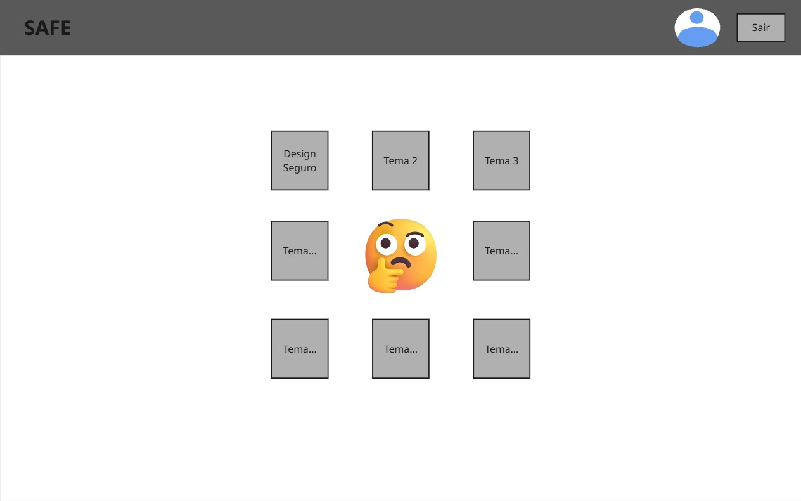
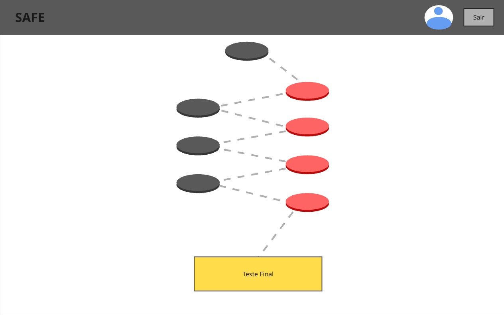
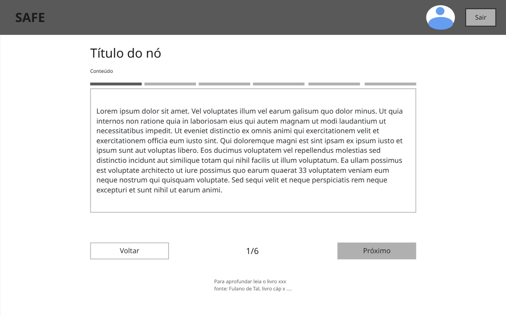
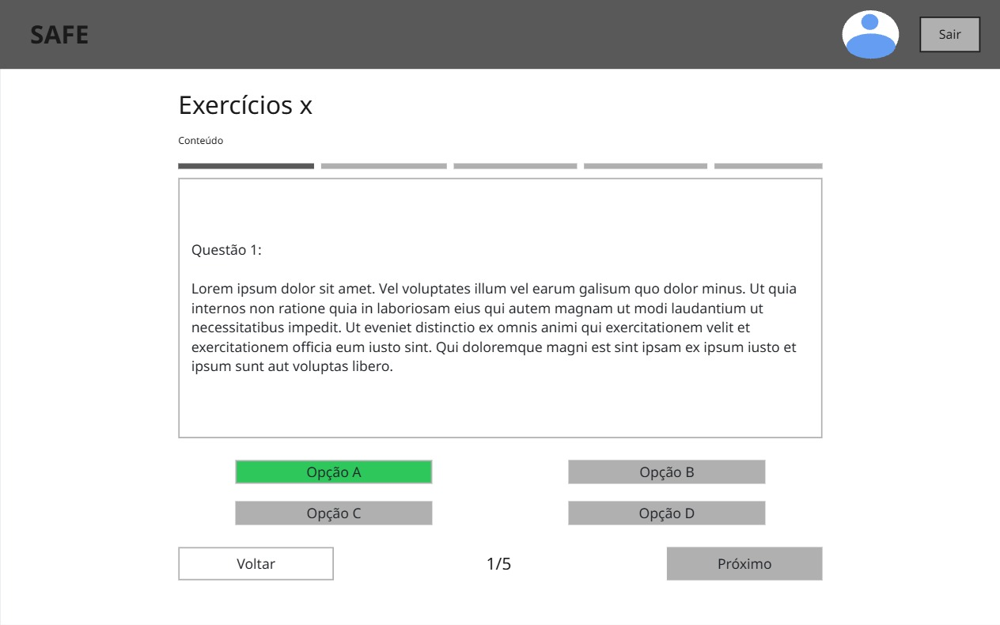

# Informações Gerais

| Sprint | Período | Data Reunião de Planejamento | Data Reunião de Review | Participantes |
|---|---|---|---|---|
| 2 | 22/09/26 - 06/10/26 | 22/09/26 | 06/10/26 | Pedro Henrique da Silva Melo e João Pedro Rodrigues Morbeck |

## Planejamento da Sprint

### 1. Objetivo da Sprint

!!! abstract "Objetivo da Sprint"
    **O que pretendemos entregar de valor prático nesta iteração para o software?** 
    Sendo a sprint que mais agrega valor ao cliente, o objetivo envolve desenvolver o motor de navegação e mapa interativo das trilhas (Feature 2), os laboratórios de prática, avaliação e apresentação de conteúdo (Feature 4). Durante o planejamento e refinamento das histórias das Features 2 e 4, chegou-se a conclusão que a Feature 5 não agrega tanto valor quanto ao que foi atribuido anteriormente, assim foi feito uma atualização no MoSCoW e incluído uma funcionalidade de revisão ao permitir que o usuário acesse os conteúdos que já foram concluídos.

### Histórias de Usuário Planejadas

- **Link para o Quadro do Projeto:** [GitHub Projects](https://github.com/CedisUnB/SecurityAPP/projects)

| Feature | ID | História de Usuário (US) | Critérios de Aceitação / Como Demonstrar | Status Final |
|---|---|---|---|---|
| 2 - Motor de Navegação de Trilhas | **US06** | Como estudante, eu quero acessar o catálogo de trilhas com visualização em cards, para que eu possa comparar os temas disponíveis e selecionar a trilha adequada aos meus objetivos de estudo. | 1. O catálogo de trilhas deve ser exibido em um formato de grade centralizada e simétrica (visual similar a uma tela de seleção de fases) (RNF02 - Usabilidade). 2. Cada trilha é representada por um card contendo título e total de nós/etapas; ao clicar no card, um modal deve exibir a descrição sumária da trilha. 3. Cards de trilhas já iniciadas pelo estudante devem exibir um indicador de progresso (ex: "3 de 8 nós concluídos"). 4. Caso não existam trilhas cadastradas, a interface deve exibir uma mensagem de estado vazio informando que nenhuma trilha está disponível no momento. 5. Ao clicar em um card, a aplicação deve abrir um modal com os detalhes da trilha. A partir dele, o usuário deve poder confirmar e ser redirecionado para a visualização do mapa da respectiva trilha. 6. A trilha deve ser estruturada com um tema específico, um conjunto de lições e um conjunto de exercícios (RN06 - Estrutura de Aprendizado Obrigatória).| Pendente |
| 2 - Motor de Navegação de Trilhas | **US07** | Como estudante, eu quero visualizar o fluxo da trilha estruturado em nós interativos (mapa) e carregar a tela de conteúdo ao acionar um nó selecionado, para que eu possa percorrer visualmente a sequência de tópicos e acessar o material didático de cada etapa. | 1. As etapas de uma trilha devem ser exibidas como nós interativos conectados visualmente, dispostos em um caminho sequencial lógico. 2. A estrutura de navegação deve obrigatoriamente intercalar os conteúdos: um nó teórico ligado a um nó de exercícios práticos, repetindo até o nó de teste final (RN07 - Ordem dos nós).  3. O nó correspondente à etapa mais avançada já alcançada pelo estudante deve ser visualmente destacado no mapa.  4. Ao clicar em um nó, a aplicação deve carregar um modal de confirmação correspondente.  5. Ao retornar, o sistema deve restaurar a visualização do mapa com foco no nó previamente selecionado. | Pendente |
| 2 - Motor de Navegação de Trilhas | **US08** | Como um Estudante, eu quero visualizar os nós que já concluí e estão disponíveis para revisão, para que eu possa acompanhar o meu progresso e acessar o material para revisar o que já aprendi. | 1. Nós já concluídos pelo estudante devem ser visualmente diferenciados dos nós ainda não concluídos no mapa da trilha. 2. Ao clicar em um nó já concluído, o sistema deve permitir reabrir o mesmo conteúdo que foi apresentado no 1° acesso do nó. 3. O progresso geral da trilha (percentual ou contagem de nós concluídos) deve ficar visível para o estudante durante a navegação pelo mapa. | Pendente |
| 2 - Motor de Navegação de Trilhas | **US09** | Como um Estudante, eu quero visualizar um nó com teste final na conclusão da trilha, para que assim eu possa avaliar meus conhecimentos e objetivos atingidos para finalizar a trilha. | 1. Ao concluir todos os nós de conteúdo (leitura/exercício) de uma trilha, um nó de teste final deve se tornar disponível no mapa (RN08 - Consumo Integral de Conteúdo). 2. O nó de teste final deve ser visualmente distinto dos demais (ex: ícone ou cor específica), indicando se tratar da etapa avaliativa conclusiva. 3. Ao concluir o teste final com sucesso (Taxa de acerto de 80%), a trilha deve ser marcada como concluída, refletindo esse status no catálogo (US06) e no mapa (RN09 - Sistema de conclusão de trilha). | Pendente |
| 4 - Apresentação e Prática de Conteúdos | **US12** | Como um Estudante, eu quero acessar o conteúdo teórico do nó de leitura, para que eu possa aprender o conteúdo antes de iniciar os exercícios. | 1. O conteúdo teórico não deve ser exibido como um texto corrido extenso, mas sim distribuído em uma estrutura navegável e interativa (balão navegável com botões "Voltar" e "Próximo") (RNF02 - Usabilidade).  2. Ao final de cada slide, o sistema deve exibir uma área dedicada às referências bibliográficas e leituras complementares daquele assunto, caso esteja cadastrado no banco de dados. 3. O estudante deve poder marcar o nó como concluído após visualizá-lo (RN12 - Sistema de Conclusão de nó). 4. Deve haver uma ação clara para finalizar o nó, retornar ao mapa da trilha e visualizar o nó concluído. | Pendente |
| 4 - Apresentação e Prática de Conteúdos | **US13** | Como um Estudante, eu quero acessar o conteúdo prático do nó de exercício, para que eu possa praticar o que aprendi do assunto e reforçar o meu conhecimento. | 1. Ao acessar um nó de exercício, o sistema deve exibir os enunciados das questões práticas vinculadas àquele nó. 2. O estudante deve poder interagir com os campos de resposta conforme o tipo de exercício. 3. O sistema deve indicar visualmente quais exercícios já foram respondidos anteriormente, mesmo antes da submissão final.  4. O estudante deve poder concluir o nó de exercício caso atinja a nota de corte (RN12 - Sistema de Conclusão de nó) | Pendente |
| 4 - Apresentação e Prática de Conteúdos | **US14** | Como um Estudante, eu quero acessar o teste final da trilha, para que eu possa testar o meu conhecimento e concluir a trilha. | 1. O nó de teste final deve exibir todas as questões avaliativas da trilha em uma única sessão de teste. 2. O sistema deve considerar questões sem respostas como incorretas (RN13 - Questões sem respostas são incorretas). 3. Ao concluir o teste, o estudante deve visualizar um resumo do resultado (pontuação, feedback, acertos e erros) RN09 - (Sistema de conclusão de trilha). | Pendente |
| 4 - Apresentação e Prática de Conteúdos | **US15** | Como um Estudante, eu quero submeter respostas para exercícios práticos e receber validação, para que eu possa testar o conhecimento adquirido na prática. | 1. Ao submeter as respostas de um nó de exercícios, o sistema deve validar pelo lado do servidor quais questões foram respondidas corretamente (RNF01 - Segurança). 2. Caso a resposta esteja incorreta, o sistema deve retornar um feedback detalhado sobre como resolver a questão (RN14 - Feedbacks de questões incorretas). 3. Respostas corretas devem ser persistidas associadas ao estudante e ao nó, para acompanhamento de métricas. | Pendente |

### Justificativa da Escolha do Escopo

O motor de navegação das trilhas e o laboratório de exercícios são as prioridades desta sprint pelo fato de comporem o principal valor da aplicação que gera aos usuários, sendo a prioridade seguida pelo que foi definido na tabela de priorização MoSCoW do [documento de requisitos](../../planning/requirements/docs_requisitos_v2.md).

### Prototipação

Essa sprint foi utilizada para fazer a prototipação das telas correspondetes às features 2 e 4.

Fonte: Autores (2026)

Fonte: Autores (2026)

Fonte: Autores (2026)

Fonte: Autores (2026)

### Feedbacks dos Stakeholders / Clientes / Orientador

Nesta sprint precisou-se atuar em atividades de requisitos de software quanto às Features planejadas para o escopo. Para isso, foram apresentadas aos clientes as opções de protótipos para a apresentação do conteúdo das trilhas, bem como as propostas visuais e funcionais para o catálogo e o mapa interativo.

A partir dessas validações, os seguintes pontos foram definidos em conjunto com os clientes:

- **Apresentação de Conteúdo (Nó de Leitura)**: A abordagem de apresentar o texto em blocos menores com navegação interna (formato de "balões navegáveis") foi amplamente preferida pelos clientes por ser visualmente mais dinâmica e menos monótona do que formatos tradicionais de texto corrido.

- **Organização das Referências**: A decisão de consolidar as referências bibliográficas e links complementares sempre ao final da estrutura do balão de conteúdo foi validada e bem recebida.

- **Catálogo de Trilhas**: Validou-se que o acesso primário às trilhas (Catálogo) adotará um layout estruturado em formato de grade (inspirado em telas clássicas de seleção de fases de jogos), facilitando a visão geral das opções disponíveis para o estudante.

- **Mapa Interativo (Navegação Interna)**: A progressão dentro de cada trilha foi validada para seguir um caminho contínuo e estritamente sequencial. A estrutura seguirá o padrão de intercalar conteúdos, fluindo de um nó teórico diretamente para um nó de exercício prático referente ao tema estudado, e em seguida para um novo nó de teoria, até que o estudante alcance o nó do teste final de avaliação.

- **Formato dos Exercícios**: Os exercícios devem atender a diferentes tipos de formatos, os quais os seguintes foram validados:
    - Múltipla escolha;
    - Verdadeiro ou Falso;
    - Completa a Frase ou Complete o Código;
    - Bloco que pode ser arrastável para a resposta.

## 2. Sprint Review

### Histórias de Usuário Validadas (Entregues)

Nenhuma história planejada foi entregue, o foco da sprint se deu pelo planejamento e validação com o cliente sobre as features 2 e 4, reavaliação do MoSCoW e MVPs, além de desenvolver as diretrizes de segurança e ser efetuada a validação de segurança da entrega da sprint 1, com isso foram definidas múltiplas atividades técnicas e refinado os requisitos funcionais correspondentes às features em questão.

## 3. Sprint Retrospective

*Avaliação do processo de trabalho da dupla:*

### ✅ O que funcionou bem (Continue)
- Mapear as questões de segurança sobre o projeto, identificando fragilidades no processo e buscando garantir a segurança do software
- Identificação das lacunas nos requisitos e planejamento das features 2 e 4
- Feedback do cliente auxiliou a tirar dúvidas do que foi proposto para a aplicação
- Nova formatação dos cards das histórias

### 🛑 O que impediu o progresso (Stop)
- Os requisitos demandaram muito tempo para serem refinados, avaliados e aprovados, consequentemente a execução atrasou
- Pensar na segurança tardiamente, apesar de ser importante, essa é uma atividade que demanda muito esforço e a execução desta atividade não funcionou

### 🚀 Ações de Melhoria para a Próxima Sprint (Act)
- Paralelizar melhor a execução das atividades, reduzindo a dependencia dos dois membros da equipe para realização das atividades
- Focar na execução adequada das atividades da sprint, evitando deixar o trabalho acumular de uma semana para outra da sprint

---

*Fonte: Autores (2026)*