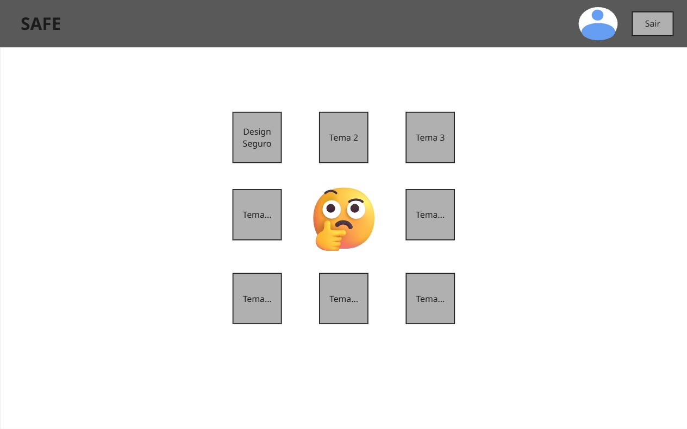
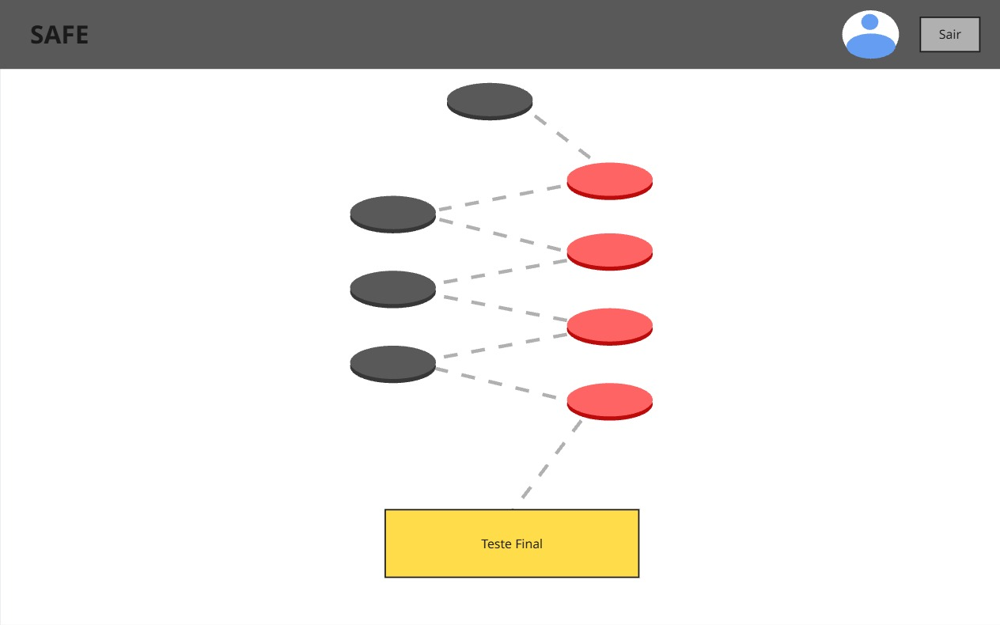
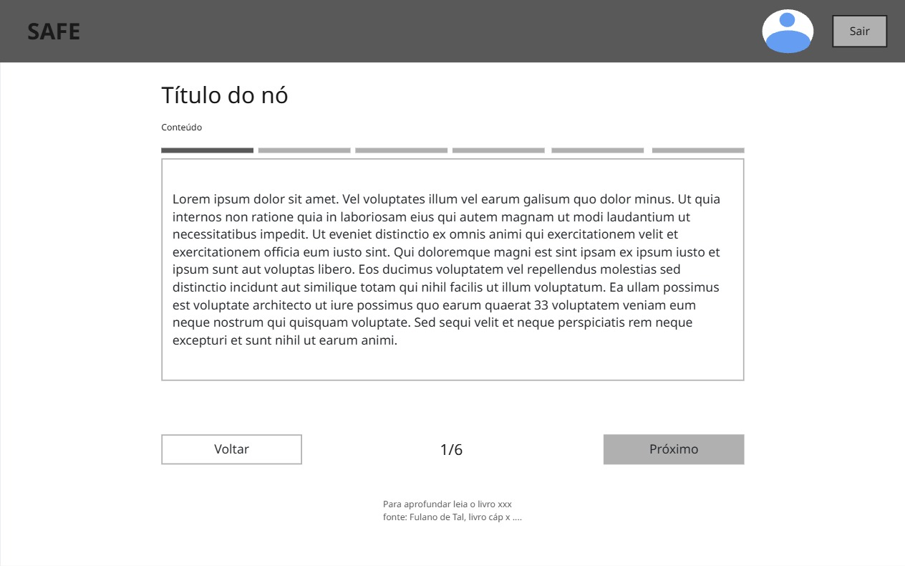
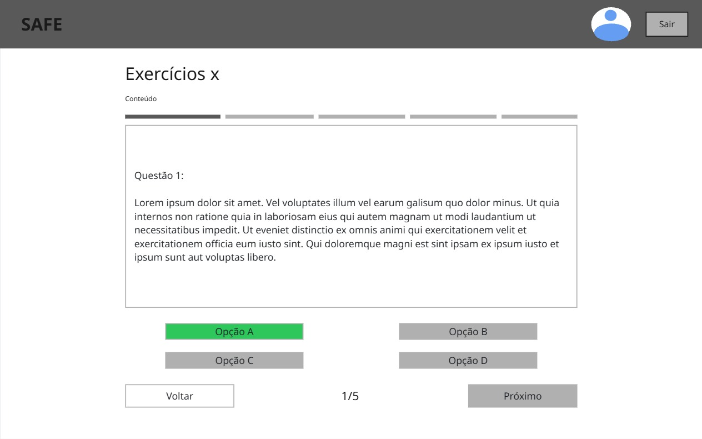

# Informações Gerais

| Sprint | Período | Data Reunião de Planejamento | Data Reunião de Review | Participantes |
|---|---|---|---|---|
| 3 | 06/10/26 - 19/10/26 | 06/10/26 | 19/10/26 | Pedro Henrique da Silva Melo e João Pedro Rodrigues Morbeck |

## Planejamento da Sprint

### 1. Objetivo da Sprint

!!! abstract "Objetivo da Sprint"
    **O que pretendemos entregar de valor prático nesta iteração para o software?** 
    Como a sprint 3 ficou apenas com o planejamento das features e desenvolvimento das diretrizes de segurança, o desenvolvimento das features 2 e 4 foram passadas para esta sprint, portanto o objetivo envolve desenvolver o motor de navegação e mapa interativo das trilhas (Feature 2), os laboratórios de prática, avaliação e apresentação de conteúdo (Feature 4) e o painel de progresso do estudante (Feature 3).

### Histórias de Usuário Planejadas

- **Link para o Quadro do Projeto:** [GitHub Projects](https://github.com/CedisUnB/SecurityAPP/projects)

| Feature | ID | História de Usuário (US) | Critérios de Aceitação / Como Demonstrar | Status Final |
|---|---|---|---|---|
| 2 - Motor de Navegação de Trilhas | **US06** | Como um Estudante, eu quero acessar o catálogo de trilhas com visualização em cards, para que eu possa comparar os temas disponíveis e selecionar a trilha adequada aos meus objetivos de estudo. | 1. O catálogo de trilhas deve ser exibido em um formato de grade centralizada e simétrica (visual similar a uma tela de seleção de fases). 2. Cada trilha é representada por um card contendo título e total de nós/etapas; ao clicar no card, um modal deve exibir a descrição sumária da trilha. 3. Cards de trilhas já iniciadas pelo estudante devem exibir um indicador de progresso (ex: "3 de 8 nós concluídos"). 4. Caso não existam trilhas cadastradas, a interface deve exibir uma mensagem de estado vazio informando que nenhuma trilha está disponível no momento. 5. Ao clicar em um card, a aplicação deve abrir um modal com os detalhes da trilha. A partir dele, o usuário deve poder confirmar e ser redirecionado para a visualização do mapa da respectiva trilha. | Entregue |
| 2 - Motor de Navegação de Trilhas | **US07** | Como um Estudante, eu quero visualizar o fluxo da trilha estruturado em nós interativos (mapa), para que eu possa percorrer visualmente a sequência de tópicos e acessar o material didático de cada etapa. | 1. As etapas de uma trilha devem ser exibidas como nós interativos conectados visualmente, dispostos em um caminho sequencial lógico. 2. A estrutura de navegação deve obrigatoriamente intercalar os conteúdos: um nó teórico ligado a um nó de exercícios práticos, repetindo até o nó de teste final. 3. O nó correspondente à etapa mais avançada já alcançada pelo estudante deve ser visualmente destacado no mapa. 4. Ao clicar em um nó, a aplicação deve carregar um modal de confirmação correspondente. 5. Ao retornar, o sistema deve restaurar a visualização do mapa com foco no nó previamente selecionado. | Entregue |
| 2 - Motor de Navegação de Trilhas | **US08** | Como um Estudante, eu quero visualizar os nós que já concluí e estão disponíveis para revisão, para que eu possa acompanhar o meu progresso e acessar o material para revisar o que já aprendi. | 1. Nós já concluídos pelo estudante devem ser visualmente diferenciados dos nós ainda não concluídos no mapa da trilha. 2. Ao clicar em um nó já concluído, o sistema deve permitir reabrir o mesmo conteúdo que foi apresentado no 1° acesso do nó. 3. O progresso geral da trilha (percentual ou contagem de nós concluídos) deve ficar visível para o estudante durante a navegação pelo mapa. | Entregue |
| 2 - Motor de Navegação de Trilhas | **US09** | Como um Estudante, eu quero visualizar um nó com teste final na conclusão da trilha, para que assim eu possa avaliar meus conhecimentos e objetivos atingidos para finalizar a trilha. | 1. Ao concluir todos os nós de conteúdo (leitura/exercício) de uma trilha, um nó de teste final deve se tornar disponível no mapa. 2. O nó de teste final deve ser visualmente distinto dos demais (ex: ícone ou cor específica), indicando se tratar da etapa avaliativa conclusiva. 3. Ao concluir o teste final com sucesso, a trilha deve ser marcada como concluída, refletindo esse status no catálogo (US06) e no mapa. | Entregue |
| 3 - Painel de Progresso | **US10** | Como um Estudante, eu quero visualizar meu percentual de progresso específico em uma trilha, para que eu saiba o quanto falta para concluir o tema atual. | 1. O card de cada trilha já iniciada no catálogo (`/tracks`) deve exibir o progresso como percentual de nós concluídos em relação ao total de nós da trilha, incluindo o nó de teste final na contagem. 2. O percentual deve ser acompanhado da contagem de nós (ex: "3/8 concluídos · 38%"), de modo que o estudante saiba quantas etapas faltam. 3. Uma trilha com todos os nós concluídos deve exibir 100% e ser identificada como concluída; uma trilha ainda não iniciada não exibe indicador de progresso, conforme a US06. 4. O percentual deve considerar apenas o progresso do estudante autenticado, sem refletir o progresso de outros usuários. 5. O percentual deve ser atualizado após o estudante concluir um nó, sem ação manual além de retornar à tela. | Pendente |
| 3 - Painel de Progresso | **US11** | Como um Estudante, eu quero visualizar meu progresso geral consolidado, para que eu consiga acompanhar meu desempenho total na plataforma. | 1. A tela de perfil (`/profile`) deve exibir um progresso geral consolidado do estudante, calculado sobre todas as trilhas da plataforma (total de nós concluídos em relação ao total de nós). 2. O consolidado deve exibir também a quantidade de trilhas concluídas em relação ao total de trilhas disponíveis (ex: "2 de 10 trilhas concluídas"). 3. Trilhas ainda não iniciadas devem entrar no total, de modo que o percentual geral reflita o que falta cumprir na plataforma. 4. Um estudante sem nenhum progresso deve ver o consolidado zerado (0%), sem erro ou área em branco; sem trilhas cadastradas, deve ver uma mensagem de estado vazio. 5. O consolidado deve considerar apenas o progresso do estudante autenticado e ser coerente com os percentuais por trilha exibidos no catálogo (US10). | Pendente |
| 4 - Apresentação e Prática de Conteúdos | **US12** | Como um Estudante, eu quero acessar o conteúdo teórico do nó de leitura, para que eu possa aprender o conteúdo antes de iniciar os exercícios. | 1. O conteúdo teórico não deve ser exibido como um texto corrido extenso, mas sim distribuído em uma estrutura navegável e interativa (balão navegável com botões "Voltar" e "Próximo"). 2. Ao final de cada slide, o sistema deve exibir uma área dedicada às referências bibliográficas e leituras complementares daquele assunto, caso esteja cadastrado no banco de dados. 3. O estudante deve poder marcar o nó como concluído após visualizá-lo. 4. Deve haver uma ação clara para finalizar o nó, retornar ao mapa da trilha e visualizar o nó concluído. | Entregue |
| 4 - Apresentação e Prática de Conteúdos | **US13** | Como um Estudante, eu quero acessar o conteúdo prático do nó de exercício, para que eu possa praticar o que aprendi do assunto e reforçar o meu conhecimento. | 1. Ao acessar um nó de exercício, o sistema deve exibir os enunciados das questões práticas vinculadas àquele nó. 2. O estudante deve poder interagir com os campos de resposta conforme o tipo de exercício. 3. O sistema deve indicar visualmente quais exercícios já foram respondidos anteriormente, mesmo antes da submissão final. | Entregue |
| 4 - Apresentação e Prática de Conteúdos | **US14** | Como um Estudante, eu quero acessar o teste final da trilha, para que eu possa testar o meu conhecimento e concluir a trilha. | 1. O nó de teste final deve exibir todas as questões avaliativas da trilha em uma única sessão de teste. 2. O sistema deve considerar questões sem respostas como incorretas. 3. Ao concluir o teste, o estudante deve visualizar um resumo do resultado (pontuação, feedback, acertos e erros). | Entregue |
| 4 - Apresentação e Prática de Conteúdos | **US15** | Como um Estudante, eu quero submeter respostas para exercícios práticos e receber validação, para que eu possa testar o conhecimento adquirido na prática. | 1. Ao submeter as respostas de um nó de exercícios, o sistema deve validar pelo lado do servidor quais questões foram respondidas corretamente. 2. Caso a resposta esteja incorreta, o sistema deve retornar um feedback detalhado sobre como resolver a questão. 3. Respostas corretas devem ser persistidas associadas ao estudante e ao nó, para acompanhamento de métricas. | Entregue |

### Justificativa da Escolha do Escopo

O motor de navegação das trilhas e o laboratório de exercícios são as prioridades desta sprint pelo fato de comporem o principal valor da aplicação que gera aos usuários, sendo a prioridade seguida pelo que foi definido na tabela de priorização MoSCoW do [documento de requisitos](../../planning/requirements/docs_requisitos_v2.md), esta planejado também o painel de progresso do estudante que fecha toda a experiência de usuário na aplicação e envolve as features 2 e 4.

### Prototipação

Essa sprint foi utilizada para fazer a prototipação das telas correspondetes às features 2 e 4.

Fonte: Autores (2026)

Fonte: Autores (2026)

Fonte: Autores (2026)

Fonte: Autores (2026)

### Feedbacks dos Stakeholders / Clientes / Orientador

## 2. Sprint Review

- Durante a execução, alguns dos critérios de aceitação precisaram ser atualizados para refletir melhor usabilidade e experiência aos usuários, como a inclusão de modais. 

- A partir das features desenvolvidas nesta feature, foi realizado pela primeira vez a execução de todos os checklists de segurança.

- Foi decidido que os checklists e DoD relacionados a segurança fossem aplicados para Pull Requests das features feitas para a branch 'dev' com o intuito de acelerar o processo de desenvolvimento.

## 3. Sprint Retrospective

*Avaliação do processo de trabalho da dupla:*

### ✅ O que funcionou bem (Continue)
- A divisão de tarefas envolvendo as features funcionou de forma adequada para maior rendimento do projeto;
-  Apesar da dependência entre features, foi possível executá-las de maneira independente;
- Aplicação dos Checklists de segurança.

### 🛑 O que impediu o progresso (Stop)
- A integração entre as feature demandou mais tempo que o esperado;

### 🚀 Ações de Melhoria para a Próxima Sprint (Act)
- Trabalhar integrações entre os trabalhos por meio de programação em pares.

---

*Fonte: Autores (2026)*